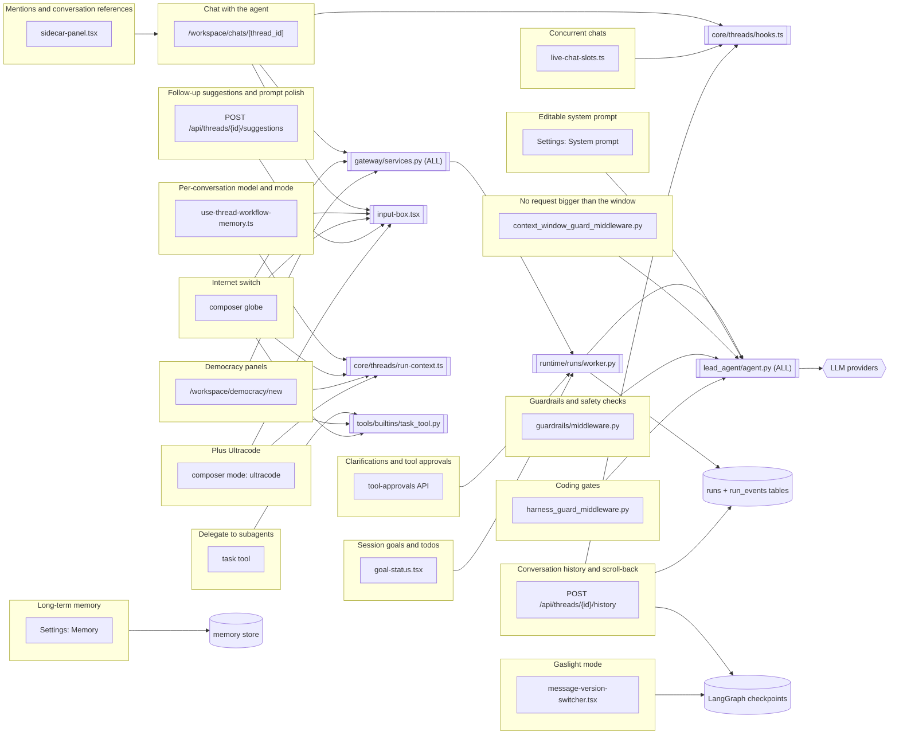

# Chat and the agent loop

### Chat with the agent
What: send a message to the lead agent and stream its reply, reasoning, tool calls and run status into the conversation.
Entry points: /workspace/chats/[thread_id], POST /api/threads/{thread_id}/runs/stream, POST /api/runs/stream
Files: frontend/src/app/workspace/chats/**, frontend/src/components/workspace/chats/chat-box.tsx, frontend/src/components/workspace/input-box.tsx, frontend/src/components/workspace/messages/**, frontend/src/core/threads/hooks.ts, frontend/src/core/messages/**, frontend/src/core/streamdown/**, backend/app/gateway/routers/thread_runs.py, backend/app/gateway/routers/runs.py, backend/app/gateway/services.py, backend/packages/harness/deerflow/runtime/runs/**, backend/packages/harness/deerflow/runtime/stream_bridge/**, backend/packages/harness/deerflow/agents/middlewares/**, backend/packages/harness/deerflow/agents/lead_agent/agent.py
Data: reads/writes the runs and run_events tables, LangGraph checkpoints, thread_meta
External: LLM providers (via backend/packages/harness/deerflow/models/factory.py)
Tests: backend/tests/test_thread_runs_page.py, backend/tests/test_run_worker_delivery.py, backend/tests/test_stream_bridge.py, backend/tests/test_client_e2e.py, frontend/tests/e2e/chat.spec.ts, frontend/tests/unit/components/workspace/messages/message-list-item.dom.test.tsx

### Conversation history and scroll-back
What: reopen a conversation and scroll back through all of it, including after a Gateway restart; unread markers follow thread activity.
Entry points: POST /api/threads/{thread_id}/history, GET /api/thread-activity, sidebar chat list
Files: backend/app/gateway/routers/threads.py, backend/app/gateway/routers/thread_activity.py, backend/app/gateway/checkpoint_lineage.py, backend/app/gateway/checkpoint_retention.py, backend/packages/harness/deerflow/runtime/events/**, backend/packages/harness/deerflow/runtime/checkpointer/**, backend/packages/harness/deerflow/config/run_events_config.py, frontend/src/components/workspace/messages/virtual-message-list.tsx, frontend/src/core/threads/message-order.ts, frontend/src/core/threads/activity.ts
Data: reads run_events (db backend by default), checkpoints, thread_reads
External: none
Tests: backend/tests/test_run_history_durability.py, backend/tests/test_run_event_store.py, backend/tests/test_thread_activity_router.py, backend/tests/test_checkpoint_lineage.py, frontend/tests/e2e/thread-history.spec.ts, frontend/tests/unit/components/workspace/messages/virtual-message-list.test.ts

### Per-conversation model and mode
What: every conversation keeps its own model, subagent model, composer mode (flash, thinking, pro, ultra) and reasoning effort, recorded on the thread, including after an edit.
Entry points: composer model picker and mode menu, PATCH /api/threads/{thread_id}, PATCH /api/v1/auth/preferences
Files: frontend/src/components/workspace/chats/use-thread-workflow-memory.ts, frontend/src/components/workspace/chats/use-chat-mode.ts, frontend/src/core/threads/thread-workflow.ts, frontend/src/core/threads/run-context.ts, frontend/src/core/models/control.ts, frontend/src/core/settings/user-preferences.ts, frontend/src/components/workspace/mode-hover-guide.tsx, backend/app/gateway/routers/user_preferences.py, backend/packages/harness/deerflow/models/selection.py, backend/packages/harness/deerflow/persistence/thread_meta/base.py
Data: thread_meta (deerflow_workflow metadata), user preferences
External: none
Tests: backend/tests/test_thread_workflow_metadata.py, backend/tests/test_user_preferences.py, backend/tests/test_model_selection.py, frontend/tests/unit/core/threads/thread-workflow.test.ts, frontend/tests/unit/core/settings/thread-context-isolation.dom.test.ts, frontend/tests/e2e/thread-workflow-memory.spec.ts

### Concurrent chats
What: a chat you leave keeps streaming in the background (live chat slots) and two conversations can run at once, while two runs in one thread still serialize.
Entry points: switching conversations mid-answer, POST /api/threads/{thread_id}/runs/stream
Files: frontend/src/core/threads/live-chat-slots.ts, frontend/src/core/threads/live-chat-slots-context.tsx, frontend/src/components/workspace/chats/chat-providers.tsx, frontend/src/components/workspace/chats/keep-alive-chat-viewport.tsx, frontend/src/components/workspace/chats/chat-instance.tsx, backend/app/gateway/run_models.py, backend/packages/harness/deerflow/runtime/runs/worker.py, backend/packages/harness/deerflow/runtime/cancellation.py
Data: runs table (one active run per thread)
External: none
Tests: backend/tests/test_concurrent_thread_runs.py, frontend/tests/unit/core/threads/live-chat-slots.test.ts, frontend/tests/unit/core/threads/live-chat-slots-busy.dom.test.tsx, frontend/tests/unit/core/threads/run-disconnect.test.ts, frontend/tests/e2e/concurrent-chats.spec.ts

### Gaslight mode
What: edit either half of a turn; an edited user message replays from there, an edited answer becomes what the assistant said, and both versions stay behind a version switcher.
Entry points: message edit button, POST /api/threads/{thread_id}/branches, POST /api/threads/{thread_id}/runs/edit-regenerate/prepare
Files: frontend/src/components/workspace/messages/message-version-switcher.tsx, frontend/src/components/workspace/chats/use-edit-versions.ts, frontend/src/core/threads/edit-versions.ts, frontend/src/core/threads/pending-edit-send.ts, frontend/src/core/threads/thread-branch-tree.ts, backend/app/gateway/edit_version_family.py, backend/app/gateway/history_seed.py, backend/app/gateway/routers/threads.py
Data: branch threads in thread_meta, seeded run_events, checkpoints
External: none
Tests: backend/tests/test_threads_router.py, frontend/tests/unit/core/threads/edit-version-answer.dom.test.tsx, frontend/tests/e2e/edit-message-versions.spec.ts

### Delegate to subagents
What: the lead agent hands subtasks to subagents (task tool, batches, external ACP agents); Ultra mode can route them to a cheaper per-thread subagent model, and local dispatch only runs as many as the GPU can hold.
Entry points: task and batch_task tools, Settings: Subagents, GET /api/threads/{thread_id}/subagent-batches, /api/subagents
Files: backend/packages/harness/deerflow/subagents/**, backend/packages/harness/deerflow/tools/builtins/task_tool.py, backend/packages/harness/deerflow/tools/builtins/batch_task_tool.py, backend/packages/harness/deerflow/tools/builtins/invoke_acp_agent_tool.py, backend/app/subagent_batches/**, backend/app/gateway/routers/subagents.py, backend/app/gateway/routers/subagent_batches.py, frontend/src/components/workspace/messages/subtask-card.tsx, frontend/src/components/workspace/thread-subagent-batches.tsx, frontend/src/core/tasks/**, frontend/src/components/workspace/settings/subagent-settings-page.tsx
Data: subagent_batches and managed_subagents tables
External: LLM providers, ACP agents when configured
Tests: backend/tests/test_task_tool_core_logic.py, backend/tests/test_subagent_executor.py, backend/tests/test_subagent_local_residency.py, backend/tests/test_subagent_batch_service.py, backend/tests/test_invoke_acp_agent_tool.py, frontend/tests/unit/components/workspace/messages/subtask-card.dom.test.tsx, frontend/tests/e2e/subagent-dropdown.spec.ts

### Democracy panels
What: pick an organizer and panelists; the organizer researches once, the panel answers and reviews each other anonymously, and the organizer synthesizes one answer that reports the split.
Entry points: /workspace/democracy/new, workspace header Democracy button
Files: frontend/src/app/workspace/democracy/new/page.tsx, frontend/src/components/workspace/democracy-setup.tsx, frontend/src/components/workspace/chats/use-democracy-launch.ts, frontend/src/core/threads/democracy.ts, backend/packages/harness/deerflow/agents/lead_agent/democracy.py, backend/packages/harness/deerflow/tools/builtins/task_tool.py, backend/packages/harness/deerflow/agents/middlewares/input_sanitization_middleware.py
Data: thread context (panel roster)
External: LLM providers (one per panelist)
Tests: backend/tests/test_democracy_panel.py, frontend/tests/unit/core/threads/democracy.test.ts, frontend/tests/e2e/democracy-panel.spec.ts

### Plus Ultracode
What: Plus Ultracode and Double Plus Ultracode composer modes, in which the agent answers by writing an inspectable workflow script that the bundled Script workflows extension runs, the second with the automatic limits lifted.
Entry points: composer mode menu (Plus Ultracode, Double Plus Ultracode), Settings: Subagents: Ultracode limits
Files: backend/extensions/sources/deerflow-extension-workflows/**, examples/deerflow-extension-workflows/**, backend/app/gateway/extension_workspaces.py, backend/packages/harness/deerflow/config/run_limit_overrides.py, backend/packages/harness/deerflow/agents/middlewares/subagent_limit_middleware.py, frontend/src/core/threads/ultracode.ts, frontend/src/components/workspace/settings/ultracode-limits-section.tsx, frontend/src/components/workspace/mode-hover-guide.tsx
Data: workflow runs in the extension store, extension workspaces on disk
External: LLM providers
Tests: backend/tests/test_ultracode_mode.py, backend/tests/test_bundled_workflows_extension.py, backend/tests/test_workflow_plugin.py, frontend/tests/unit/core/threads/ultracode.test.ts, frontend/tests/e2e/ultracode-mode.spec.ts

### Long-term memory
What: the agent learns facts about you and injects them into later runs, off by default and opted into per browser; pluggable backends (DeerMem, mem0, Honcho, OpenViking).
Entry points: Settings: Memory, GET/PUT /api/memory, memory tools
Files: backend/packages/harness/deerflow/agents/memory/**, backend/packages/harness/deerflow/agents/middlewares/memory_middleware.py, backend/app/gateway/routers/memory.py, backend/packages/harness/deerflow/config/memory_config.py, frontend/src/core/memory/**, frontend/src/components/workspace/settings/memory-settings-page.tsx, frontend/src/app/api/memory/**, docker/docker-compose.openviking.yaml
Data: memory store (per-user files or the configured backend)
External: LLM providers (extraction), mem0/Honcho/OpenViking when configured
Tests: backend/tests/test_memory_router.py, backend/tests/test_memory_middleware.py, backend/tests/test_lead_agent_memory_toggle.py, frontend/tests/e2e/memory-settings.spec.ts, frontend/tests/unit/app/api/memory-route.test.ts

### Follow-up suggestions and prompt polish
What: opt-in follow-up chips after an answer on a model you pick, and a one-click polish of the prompt you are typing.
Entry points: Settings: Suggestions, POST /api/threads/{thread_id}/suggestions, POST /api/input-polish
Files: backend/app/gateway/routers/suggestions.py, backend/app/gateway/routers/input_polish.py, backend/packages/harness/deerflow/config/suggestions_config.py, backend/packages/harness/deerflow/config/input_polish_config.py, frontend/src/core/suggestions/**, frontend/src/core/input-polish/**, frontend/src/components/workspace/settings/suggestions-settings-page.tsx, backend/packages/harness/deerflow/utils/oneshot_llm.py
Data: auxiliary usage counters
External: LLM providers
Tests: backend/tests/test_suggestions_router.py, backend/tests/test_input_polish_router.py, backend/tests/test_suggestions_model_authorization.py, frontend/tests/e2e/suggestions-settings.spec.ts, frontend/tests/unit/core/suggestions/placeholders.test.ts

### Editable system prompt
What: see the system prompt template in force, edit it and preview it with every placeholder filled in, applied without a restart.
Entry points: Settings: System prompt, GET/PUT /api/system-prompt, POST /api/system-prompt/preview
Files: backend/app/gateway/routers/system_prompt.py, backend/packages/harness/deerflow/agents/lead_agent/system_prompt_store.py, backend/packages/harness/deerflow/agents/lead_agent/prompt.py, frontend/src/components/workspace/settings/system-prompt-settings-page.tsx, frontend/src/core/system-prompt/**
Data: system prompt override file under the runtime home
External: none
Tests: backend/tests/test_system_prompt_store.py, backend/tests/test_system_prompt_router.py, backend/tests/test_lead_agent_prompt.py, frontend/tests/unit/core/system-prompt/api.test.ts

### No request bigger than the window
What: every model call is measured against the serving model's window; the oldest tool results are dropped, long histories summarized or compacted, and tool output budgeted so a local 32K model still answers.
Entry points: every model call, manual context compaction, the context usage badge
Files: backend/packages/harness/deerflow/agents/middlewares/context_window_guard_middleware.py, backend/packages/harness/deerflow/agents/middlewares/summarization_middleware.py, backend/packages/harness/deerflow/agents/middlewares/tool_output_budget_middleware.py, backend/packages/harness/deerflow/runtime/context_compaction.py, backend/packages/harness/deerflow/utils/context_budget.py, backend/app/gateway/context_usage.py, frontend/src/components/workspace/context-usage-badge.tsx
Data: checkpoints (summaries)
External: LLM providers (summarization)
Tests: backend/tests/test_context_fit_critical.py, backend/tests/test_context_overflow_guard.py, backend/tests/test_summarization_middleware.py, backend/tests/test_context_compaction.py, backend/tests/test_tool_output_budget_middleware.py, frontend/tests/unit/components/workspace/context-usage-badge.test.ts

### Internet switch
What: a globe on the composer takes this conversation offline: search, fetch, browser control, MCP and external agents are left out of the run, and subagents inherit it.
Entry points: composer globe toggle, run context internet_enabled
Files: backend/packages/harness/deerflow/tools/internet_access.py, backend/packages/harness/deerflow/tools/tools.py, backend/app/gateway/services.py, frontend/src/components/workspace/input-box.tsx, frontend/src/core/threads/run-context.ts, frontend/src/core/settings/local.ts
Data: per-thread setting in local settings
External: none
Tests: backend/tests/test_internet_toggle.py, frontend/tests/unit/core/threads/internet-toggle.test.ts, frontend/tests/unit/core/settings/internet-toggle-persistence.dom.test.ts, frontend/tests/e2e/internet-toggle.spec.ts

### Clarifications and tool approvals
What: the agent can stop to ask a clarifying question, and tool calls can wait for your approval (ask, auto or full mode) before they run.
Entry points: human input card, tool approval mode menu, POST /api/threads/{thread_id}/runs/{run_id}/tool-approvals/{request_id}
Files: backend/packages/harness/deerflow/approvals/**, backend/packages/harness/deerflow/tools/builtins/clarification_tool.py, backend/packages/harness/deerflow/agents/middlewares/clarification_middleware.py, backend/packages/harness/deerflow/agents/human_input.py, backend/app/gateway/hitl_approval.py, backend/app/gateway/tool_approvals.py, frontend/src/components/workspace/messages/human-input-card.tsx, frontend/src/components/workspace/tool-approval-mode.tsx, frontend/src/core/threads/tool-approvals.ts
Data: tool_approvals table
External: none
Tests: backend/tests/test_clarification_middleware.py, backend/tests/test_tool_approval_runtime.py, backend/tests/test_hitl_approval_api.py, frontend/tests/unit/components/workspace/messages/human-input-card.dom.test.tsx, frontend/tests/e2e/tool-approval.spec.ts

### Session goals and todos
What: set a goal for the conversation that is checked each turn, keep a todo list in plan mode, and carry task notes and history recall between runs.
Entry points: goal status panel, POST goal from chat, write_todos tool, task notes tools
Files: backend/packages/harness/deerflow/runtime/goal.py, backend/packages/harness/deerflow/runtime/goal_progress.py, backend/packages/harness/deerflow/agents/goal_state.py, backend/packages/harness/deerflow/agents/task_continuity/**, backend/packages/harness/deerflow/agents/middlewares/todo_middleware.py, frontend/src/components/workspace/goal-status.tsx, frontend/src/components/workspace/todo-list.tsx, frontend/src/core/todos/**, contracts/thread_goal_contract.json
Data: thread state (goal, todos), task notes
External: LLM providers (goal check)
Tests: backend/tests/test_goal_from_chat_route.py, backend/tests/test_goal_operation_progress.py, backend/tests/test_task_continuity.py, backend/tests/test_todo_middleware.py, frontend/tests/unit/components/workspace/goal-status.dom.test.tsx, frontend/tests/e2e/goal-status.spec.ts

### Guardrails and safety checks
What: input sanitization, PII redaction, guardrail providers (built-in, OpenAI decisions, TypeSafe) and safety finish-reason handling that stop or redact unsafe runs.
Entry points: every run (guardrails middleware chain)
Files: backend/packages/harness/deerflow/guardrails/**, backend/packages/harness/deerflow/typesafe/**, backend/packages/harness/deerflow/openai_decisions/**, backend/packages/harness/deerflow/agents/middlewares/pii_redaction_middleware.py, backend/packages/harness/deerflow/agents/middlewares/input_sanitization_middleware.py, backend/packages/harness/deerflow/agents/middlewares/safety_finish_reason_middleware.py, backend/packages/harness/deerflow/config/guardrails_config.py
Data: none
External: OpenAI moderation decisions or TypeSafe when configured
Tests: backend/tests/test_guardrail_middleware.py, backend/tests/test_pii_redaction_middleware.py, backend/tests/test_input_sanitization_middleware.py, backend/tests/test_safety_finish_reason_middleware.py, backend/tests/test_typesafe_guardrail_provider.py

### Mentions and conversation references
What: @-mention skills, files and extensions in the composer, attach up to three earlier conversations for the agent to read, or ask about a message in a side chat (sidecar).
Entry points: @ in the composer, Reference a conversation button, sidecar panel
Files: frontend/src/components/workspace/mentions/**, frontend/src/components/workspace/conversation-references/**, frontend/src/components/workspace/sidecar/**, frontend/src/core/sidecar/**, frontend/src/core/conversation-references/**, backend/packages/harness/deerflow/tools/conversation.py, backend/app/gateway/conversation_access.py, backend/app/gateway/conversation_reader.py
Data: reads other threads' visible messages for the length of the run
External: none
Tests: backend/tests/test_read_conversation_tool.py, backend/tests/test_conversation_references_context_channel.py, frontend/tests/unit/components/workspace/conversation-references-flow.dom.test.tsx, frontend/tests/unit/core/sidecar/context.test.ts, frontend/tests/e2e/mentions.spec.ts, frontend/tests/e2e/sidecar-chat.spec.ts

### Coding gates
What: checks that keep coding runs honest: a syntax check after every file write, an ambiguous str_replace refused instead of guessed, a harness guard on risky edits, and a completion review before the agent says it is done.
Entry points: write_file and str_replace tools, the middleware chain at run end
Files: backend/packages/harness/deerflow/sandbox/syntax_check.py, backend/packages/harness/deerflow/sandbox/tools.py, backend/packages/harness/deerflow/agents/middlewares/harness_guard_middleware.py, backend/packages/harness/deerflow/agents/middlewares/completion_review_middleware.py, backend/packages/harness/deerflow/config/harness_guard_config.py
Data: sandbox files
External: none
Tests: backend/tests/test_sandbox_syntax_check.py, backend/tests/test_str_replace_ambiguous_match.py, backend/tests/test_completion_review_middleware.py, backend/tests/test_harness_guard_middleware.py
