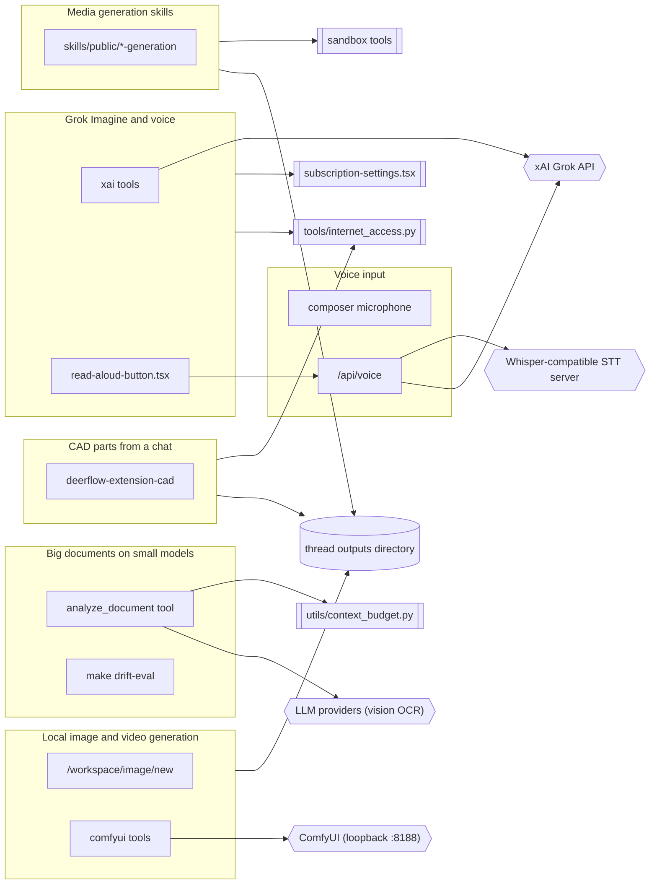

# Generation, media and documents

### Local image and video generation
What: image and short video generation on a local ComfyUI that is provisioned and stocked at startup, with a GPU residency arbiter shared with Ollama and a judged refine loop.
Entry points: /workspace/image/new, workspace header Image button, ComfyUI generation tools, make comfy-*
Files: backend/packages/harness/deerflow/community/comfyui/**, backend/packages/harness/deerflow/config/media_config.py, scripts/comfyui.sh, scripts/comfyui_models.py, scripts/detect_comfyui.py, docker/docker-compose.comfyui.yml, frontend/src/app/workspace/image/new/page.tsx, frontend/src/components/workspace/image-generation-setup.tsx, frontend/src/components/workspace/chats/use-image-launch.ts, frontend/src/core/threads/image-generation.ts
Data: thread outputs directory, ComfyUI model folder
External: ComfyUI on loopback port 8188
Tests: backend/tests/test_comfyui_tools.py, backend/tests/test_comfyui_models.py, backend/tests/test_comfyui_video.py, backend/tests/test_gpu_arbiter.py, backend/tests/test_refine_session.py, backend/tests/test_detect_comfyui.py, frontend/tests/unit/components/workspace/image-generation-setup.dom.test.tsx, frontend/tests/unit/core/threads/image-generation.test.ts

### Grok Imagine and voice
What: on a connected Grok plan an administrator can switch on Grok Imagine image and video generation, X search and Grok voice (read answers aloud, transcribe speech).
Entry points: Settings: Models: Grok features, read-aloud button, xAI tools
Files: backend/packages/harness/deerflow/community/xai/**, backend/app/gateway/routers/voice.py, frontend/src/components/workspace/read-aloud-button.tsx, frontend/src/components/workspace/settings/subscription-settings.tsx
Data: Grok subscription credentials, thread outputs directory
External: xAI Grok API
Tests: backend/tests/test_grok_features.py, backend/tests/test_grok_xai_tools.py, frontend/tests/unit/core/voice-input/read-aloud.test.ts

### Voice input
What: dictation that tries Chrome's on-device recognition, then a Whisper-compatible service on your machine; the vendor cloud is opt-in.
Entry points: composer microphone, POST /api/voice/transcribe
Files: frontend/src/core/voice-input/**, backend/app/gateway/routers/voice.py, backend/packages/harness/deerflow/community/speech/**, backend/packages/harness/deerflow/config/voice_config.py
Data: none
External: browser speech recognition, a local Whisper-compatible STT server
Tests: backend/tests/test_voice_stt.py, frontend/tests/unit/core/voice-input/voice-tiers.test.ts, frontend/tests/unit/core/voice-input/recorder.test.ts, frontend/tests/unit/core/voice-input/speech-recognition.test.ts

### CAD parts from a chat
What: describe a part and get an editable CAD script plus STEP, STL and GLB files, built by the bundled CAD extension without running the model's code.
Entry points: CAD extension tools, cad-modeling skill
Files: backend/extensions/sources/deerflow-extension-cad/**, examples/deerflow-extension-cad/**, skills/public/cad-modeling/**
Data: thread outputs directory
External: none (works with the internet switch off)
Tests: backend/tests/test_cad_extension.py, backend/tests/test_bundled_cad_extension.py, backend/tests/test_cad_runtime_deps.py, tests/skills/test_cad_modeling.py

### Big documents on small models
What: analyze_document reads a PDF, EPUB, HTML or zipped book in parts sized for the serving model, transcribes scanned PDFs with a vision model, and make drift-eval checks that long-document answers stay on the question.
Entry points: analyze_document tool, make drift-eval
Files: backend/packages/harness/deerflow/documents/**, backend/packages/harness/deerflow/tools/builtins/analyze_document_tool.py, backend/packages/harness/deerflow/utils/context_budget.py, backend/packages/harness/deerflow/config/documents_config.py, backend/scripts/benchmark/drift_eval/**
Data: thread uploads directory
External: LLM providers (vision OCR, judge model for drift-eval)
Tests: backend/tests/test_analyze_document_tool.py, backend/tests/test_document_analysis.py, backend/tests/test_document_chunking.py, backend/tests/test_document_extraction.py, backend/tests/test_document_ocr.py, backend/tests/test_document_formats.py, backend/tests/test_bench_drift_eval.py

### Media generation skills
What: bundled skills that make images, videos, music, podcasts, slide decks, charts and newsletters inside the sandbox.
Entry points: the skills in the composer or by name (/image-generation, /ppt-generation, ...)
Files: skills/public/image-generation/**, skills/public/image-refine/**, skills/public/video-generation/**, skills/public/music-generation/**, skills/public/podcast-generation/**, skills/public/ppt-generation/**, skills/public/chart-visualization/**, skills/public/newsletter-generation/**
Data: thread outputs directory
External: the generation APIs each skill names
Tests: tests/skills/test_image_generation.py, tests/skills/test_video_generation.py, tests/skills/test_music_generation.py, tests/skills/test_podcast_generation.py, tests/skills/test_ppt_transparency.py, tests/skills/test_chart_visualization.py
