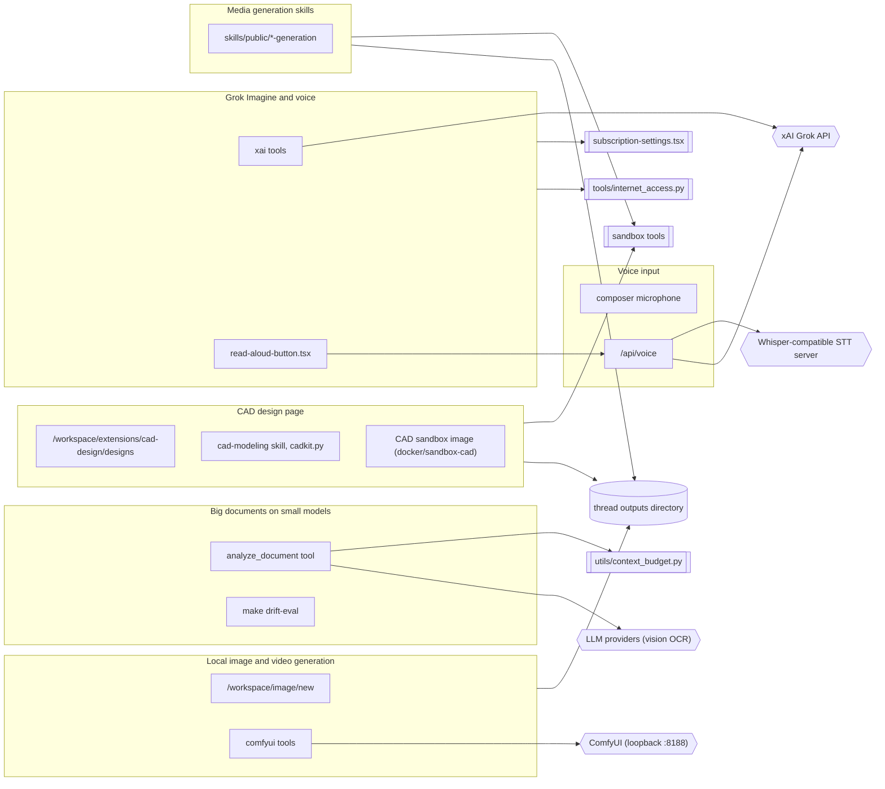

# Generation, media and documents

### Local image and video generation
What: image and short video generation on a local ComfyUI that is provisioned and stocked at startup, with a GPU residency arbiter shared with Ollama and a judged refine loop.
Entry points: /workspace/image/new, workspace header Image button, ComfyUI generation tools, make comfy-*
Files: backend/packages/harness/deerflow/community/comfyui/**, backend/packages/harness/deerflow/config/media_config.py, scripts/comfyui.sh, scripts/comfyui_models.py, scripts/detect_comfyui.py, docker/docker-compose.comfyui.yml, frontend/src/app/workspace/image/new/page.tsx, frontend/src/components/workspace/image-generation-setup.tsx, frontend/src/components/workspace/chats/use-image-launch.ts, frontend/src/core/threads/image-generation.ts
Data: thread outputs directory, ComfyUI model folder
External: ComfyUI on loopback port 8188
Tests: backend/tests/test_comfyui_tools.py, backend/tests/test_comfyui_models.py, backend/tests/test_comfyui_video.py, backend/tests/test_gpu_arbiter.py, backend/tests/test_refine_session.py, backend/tests/test_detect_comfyui.py, frontend/tests/unit/components/workspace/image-generation-setup.dom.test.tsx, frontend/tests/unit/core/threads/image-generation.test.ts

### Grok Imagine and voice
What: on a connected Grok plan an administrator can switch on Grok Imagine image and video generation, X search and Grok voice (read answers aloud, transcribe speech).
Entry points: Settings: Models: Grok features, read-aloud button, xAI tools
Files: backend/packages/harness/deerflow/community/xai/**, backend/app/gateway/routers/voice.py, frontend/src/components/workspace/read-aloud-button.tsx, frontend/src/components/workspace/settings/subscription-settings.tsx
Data: Grok subscription credentials, thread outputs directory
External: xAI Grok API
Tests: backend/tests/test_grok_features.py, backend/tests/test_grok_xai_tools.py, frontend/tests/unit/core/voice-input/read-aloud.test.ts

### Voice input
What: dictation that tries Chrome's on-device recognition, then a Whisper-compatible service on your machine; the vendor cloud is opt-in.
Entry points: composer microphone, POST /api/voice/transcribe
Files: frontend/src/core/voice-input/**, backend/app/gateway/routers/voice.py, backend/packages/harness/deerflow/community/speech/**, backend/packages/harness/deerflow/config/voice_config.py
Data: none
External: browser speech recognition, a local Whisper-compatible STT server
Tests: backend/tests/test_voice_stt.py, frontend/tests/unit/core/voice-input/voice-tiers.test.ts, frontend/tests/unit/core/voice-input/recorder.test.ts, frontend/tests/unit/core/voice-input/speech-recognition.test.ts

### CAD design page
What: describe a part or mechanism and the agent designs it in the conversation's container the way a CAD engineer would: parametric multi-body OpenSCAD, each body rendered with the openscad CLI, clashes and gaps checked through every pose and swing (trimesh and manifold3d), sections and a shaded render it looks at, print checks with a support-free PrusaSlicer run, hand load calculations, and STEP and 3MF at the end, each read back against its body, with a print and assembly guide PDF, a zip with a manifest, dimension studies, joint test pieces and a compare that proves a CadQuery rebuild (cadkit.py in the cad-modeling skill, on the CAD sandbox image). Designs in the sidebar opens a page with the conversation on one half and the newest version on the other: its bodies in 3D, the view images, the checks and the files; every render is a version folder. The same skill works from an ordinary chat. Model-written code runs only in the per-thread container, never in the Gateway. Host hooks it uses: AgentRuns.start stream_mode and delete_thread (extension API 0.2.14), HostPolicySnapshot.sandbox_container (0.2.15), joinRunStream, threadFiles, composerControls (the chat's own model picker, mode and effort), models, layout full, the box icon, the deerflow_listed hide flag and the MODEL_LOGICAL request adjustment that carries its brief (Extensions and plugins).
Entry points: /workspace/extensions/cad-design/designs, the cad-modeling skill, make sandbox-cad-image, make sandbox-enable MODE=container IMAGE=cad, make extension-disable NAME=cad-design
Files: examples/deerflow-extension-cad-design/**, backend/extensions/sources/deerflow-extension-cad-design/**, skills/public/cad-modeling/**, docker/sandbox-cad/**
Data: design store (SQLite at cad-design/designs.sqlite under DEER_FLOW_HOME), the design's hidden thread and its outputs directory (/mnt/user-data/outputs/design/v<N>/)
External: Docker and the CAD sandbox image (Ubuntu and PyPI packages fetched when the image is built; nothing at run time)
Tests: examples/deerflow-extension-cad-design/tests/test_store.py, examples/deerflow-extension-cad-design/tests/test_actions.py, examples/deerflow-extension-cad-design/tests/test_middleware.py, examples/deerflow-extension-cad-design/tests/test_install.py, examples/deerflow-extension-cad-design/tests/test_cad_design_registration.py, examples/deerflow-extension-cad-design/tests/build.test.mjs, examples/deerflow-extension-cad-design/tests/files.test.mjs, examples/deerflow-extension-cad-design/tests/run-stream.test.mjs, examples/deerflow-extension-cad-design/tests/outcomes.test.mjs, tests/skills/test_cad_modeling.py, tests/skills/test_cadkit.py, backend/tests/test_bundled_cad_design_extension.py, backend/tests/test_cad_design_end_to_end.py, backend/tests/test_context_fit_critical.py, backend/tests/test_extension_policy.py, backend/tests/test_extension_agent_runs.py, backend/tests/test_sandbox_cad_image.py, backend/tests/test_sandbox_toggle.py, frontend/tests/unit/core/extensions/composer-controls.test.ts, frontend/tests/unit/core/extensions/services.test.ts, frontend/tests/unit/components/workspace/plugin-composer-controls.dom.test.tsx, frontend/tests/e2e/cad-design.spec.ts

### Big documents on small models
What: analyze_document reads a PDF, EPUB, HTML or zipped book in parts sized for the serving model, transcribes scanned PDFs with a vision model, and make drift-eval checks that long-document answers stay on the question.
Entry points: analyze_document tool, make drift-eval
Files: backend/packages/harness/deerflow/documents/**, backend/packages/harness/deerflow/tools/builtins/analyze_document_tool.py, backend/packages/harness/deerflow/utils/context_budget.py, backend/packages/harness/deerflow/config/documents_config.py, backend/scripts/benchmark/drift_eval/**
Data: thread uploads directory
External: LLM providers (vision OCR, judge model for drift-eval)
Tests: backend/tests/test_analyze_document_tool.py, backend/tests/test_document_analysis.py, backend/tests/test_document_chunking.py, backend/tests/test_document_extraction.py, backend/tests/test_document_ocr.py, backend/tests/test_document_formats.py, backend/tests/test_bench_drift_eval.py

### Media generation skills
What: bundled skills that make images, videos, music, podcasts, slide decks, charts and newsletters inside the sandbox.
Entry points: the skills in the composer or by name (/image-generation, /ppt-generation, ...)
Files: skills/public/image-generation/**, skills/public/image-refine/**, skills/public/video-generation/**, skills/public/music-generation/**, skills/public/podcast-generation/**, skills/public/ppt-generation/**, skills/public/chart-visualization/**, skills/public/newsletter-generation/**
Data: thread outputs directory
External: the generation APIs each skill names
Tests: tests/skills/test_image_generation.py, tests/skills/test_video_generation.py, tests/skills/test_music_generation.py, tests/skills/test_podcast_generation.py, tests/skills/test_ppt_transparency.py, tests/skills/test_chart_visualization.py
