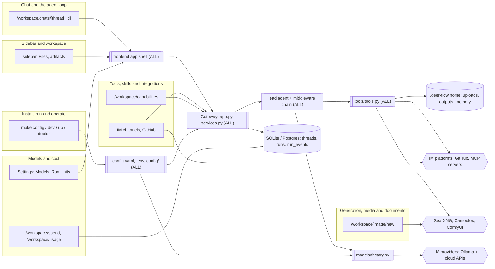

# Repo map

Synced by change cycle: 2026-11-21, level 2, "initial repo map"

What the app does, feature by feature, and which files, data and external
services each feature uses. Each area file opens with its own board and holds
the feature entries; this file holds the overview and the full file → features
index.

| Area | Features |
|---|---|
| [Chat and the agent loop](chat-and-agent.md) | 18 |
| [Models and cost](models-and-cost.md) | 11 |
| [Sidebar and workspace](sidebar-and-workspace.md) | 18 |
| [Generation, media and documents](generation-and-media.md) | 6 |
| [Tools, skills and integrations](integrations-and-channels.md) | 18 |
| [Install, run and operate](ops-and-install.md) | 10 |

## Overview board

## How to read this

- **Feature entries** live in the area files, one `### Name` per feature, with
  `What:`, `Entry points:`, `Files:`, `Data:`, `External:` and `Tests:`. Test
  paths are repo-root-relative.
- **Look up a changed file** in the table below and run the tests of every
  feature listed. `ALL` means every feature (dependency manifests and
  lockfiles, build config, config loading, database schema and migrations, the
  app shell, global styles, auth, the lead agent assembly); `none (dev tooling)`
  means no feature ships it.
- **Matching rule: the most specific row wins.** An exact path beats any
  pattern; between patterns, the longer pattern string wins. In a pattern `**`
  matches across directories, and `*` and `?` stay inside one path segment.
  Two equally specific rows never disagree.
- **Left out of the table** (every other tracked file must match a row):
  docs (everything under `docs/`, every `*.md` and every licence text, except
  under `skills/public/`, which ships as skill content), tests (`backend/tests/`,
  `frontend/tests/`, `tests/`, any `tests/` or `test/` directory, `test_*.py`,
  `conftest.py`, `*.test.*` and `*.spec.*` files, and
  `backend/extension_test_fixtures/`). No file is excluded as generated or
  vendored: lockfiles are `ALL`, and generated files that ship (such as
  `frontend/src/core/extensions/bundled-documentation.json`) are mapped like
  source.
- `backend/tests/test_repo_map.py` enforces all of this: every shipping file
  matches a row, no row is stale, every feature in the table has an entry,
  every `Files:` entry and listed test exists, and every area file opens with
  its board (an `# Area` title may precede it).

## File → features index

| File | Features |
|---|---|
| `Makefile` | ALL |
| `config.example.yaml` | ALL |
| `.env.example` | ALL |
| `extensions_config.example.json` | MCP servers, Skills, Extensions and plugins |
| `.dockerignore` | Run the stack |
| `.gitignore` | none (dev tooling) |
| `.gitattributes` | none (dev tooling) |
| `.pre-commit-config.yaml` | none (dev tooling) |
| `deer-flow.code-workspace` | none (dev tooling) |
| `.github/**` | none (dev tooling) |
| `.agent/**` | none (dev tooling) |
| `contracts/knowledge_sources.v1.json` | Knowledge retrieval |
| `contracts/run_event_stream_contract.json` | Chat with the agent, Conversation history and scroll-back |
| `contracts/scheduled_goal_notes_contract.json` | Scheduled tasks, Session goals and todos |
| `contracts/scheduled_task_errors_contract.json` | Scheduled tasks |
| `contracts/skill_review/**` | Create and review skills |
| `contracts/slash_skill_contract.json` | Skills |
| `contracts/subagent_status_contract.json` | Delegate to subagents |
| `contracts/thread_goal_contract.json` | Session goals and todos |
| `contracts/thread_origin_contract.json` | Chat with the agent, Scheduled tasks, IM channels |
| `contracts/ui_locales.v1.json` | Appearance and language |
| `backend/*` | ALL |
| `backend/Dockerfile` | Run the stack |
| `backend/langgraph.json` | Embedded client and API |
| `backend/ruff.toml` | none (dev tooling) |
| `backend/.gitignore` | none (dev tooling) |
| `backend/.test_durations` | none (dev tooling) |
| `backend/.vscode/**` | none (dev tooling) |
| `backend/debug.py` | none (dev tooling) |
| `backend/docs/memory-settings-sample.json` | Long-term memory |
| `backend/samples/**` | Long-term memory |
| `backend/scripts/**` | none (dev tooling) |
| `backend/scripts/benchmark/drift_eval/**` | Big documents on small models |
| `backend/scripts/migrate_*.py` | Install and configure |
| `backend/packages/harness/pyproject.toml` | ALL |
| `backend/packages/extension-api/pyproject.toml` | ALL |
| `backend/packages/extension-api/**` | Extensions and plugins |
| `backend/extensions/sources/deerflow-extension-cad/**` | CAD parts from a chat |
| `backend/extensions/sources/deerflow-extension-workflows/**` | Plus Ultracode |
| `backend/app/__init__.py` | ALL |
| `backend/app/channels/**` | IM channels |
| `backend/app/channels/github.py` | GitHub agents |
| `backend/app/mcp_tasks/**` | MCP servers |
| `backend/app/scheduler/**` | Scheduled tasks |
| `backend/app/subagent_batches/**` | Delegate to subagents |
| `backend/app/gateway/*.py` | ALL |
| `backend/app/gateway/auth/**` | ALL |
| `backend/app/gateway/github/**` | GitHub agents |
| `backend/app/gateway/artifact_archive.py` | Artifacts and previews |
| `backend/app/gateway/auth_disabled.py` | Passwordless on your own network |
| `backend/app/gateway/browser_capability.py` | Browser control |
| `backend/app/gateway/capabilities.py` | Extensions and plugins |
| `backend/app/gateway/checkpoint_*.py` | Conversation history and scroll-back |
| `backend/app/gateway/context_usage.py` | No request bigger than the window |
| `backend/app/gateway/conversation_*.py` | Mentions and conversation references |
| `backend/app/gateway/dependency_update.py` | Self-updating browser and search |
| `backend/app/gateway/edit_version_family.py` | Gaslight mode, Live cost overview |
| `backend/app/gateway/extension_*.py` | Extensions and plugins |
| `backend/app/gateway/extension_workspaces.py` | Extensions and plugins, Plus Ultracode |
| `backend/app/gateway/health.py` | Run the stack |
| `backend/app/gateway/history_seed.py` | Gaslight mode, Conversation history and scroll-back |
| `backend/app/gateway/*approval*.py` | Clarifications and tool approvals |
| `backend/app/gateway/knowledge_scope_admission.py` | Knowledge retrieval |
| `backend/app/gateway/langgraph_studio.py` | Embedded client and API |
| `backend/app/gateway/*mcp*.py` | MCP servers |
| `backend/app/gateway/model_discovery.py` | Model providers, Subscription models |
| `backend/app/gateway/pricing.py` | Live cost overview, Spend caps and run limits, Spend page, Token usage page |
| `backend/app/gateway/run_*.py` | Chat with the agent, Concurrent chats |
| `backend/app/gateway/run_notifications.py` | Installable PWA and push notifications |
| `backend/app/gateway/scheduled_task_*.py` | Scheduled tasks |
| `backend/app/gateway/search_corpus.py` | Search conversations |
| `backend/app/gateway/share_*.py` | Share and export a conversation |
| `backend/app/gateway/skill_export.py` | Skills |
| `backend/app/gateway/spend_budget.py` | Spend caps and run limits |
| `backend/app/gateway/sse_headers.py` | Chat with the agent |
| `backend/app/gateway/trace_middleware.py` | Tracing and observability |
| `backend/app/gateway/upload_ingestion.py` | Upload files |
| `backend/app/gateway/web_push.py` | Installable PWA and push notifications |
| `backend/app/gateway/routers/__init__.py` | ALL |
| `backend/app/gateway/routers/admin_users.py` | Sign in and accounts |
| `backend/app/gateway/routers/agent_generation.py` | Generate an agent from history |
| `backend/app/gateway/routers/agents.py` | Custom agents |
| `backend/app/gateway/routers/artifacts.py` | Artifacts and previews |
| `backend/app/gateway/routers/assistants_compat.py` | Embedded client and API |
| `backend/app/gateway/routers/auth.py` | Sign in and accounts |
| `backend/app/gateway/routers/browser.py` | Browser control |
| `backend/app/gateway/routers/capabilities.py` | Extensions and plugins |
| `backend/app/gateway/routers/channel*.py` | IM channels |
| `backend/app/gateway/routers/chat_organize.py` | Clean-up mode |
| `backend/app/gateway/routers/console.py` | Spend page, Token usage page, Live cost overview |
| `backend/app/gateway/routers/features.py` | ALL |
| `backend/app/gateway/routers/feedback.py` | Chat with the agent |
| `backend/app/gateway/routers/folder_ledger.py` | Conversation files and shared folders |
| `backend/app/gateway/routers/github_webhooks.py` | GitHub agents |
| `backend/app/gateway/routers/im_notification_preferences.py` | IM channels |
| `backend/app/gateway/routers/input_polish.py` | Follow-up suggestions and prompt polish |
| `backend/app/gateway/routers/integrations.py` | Lark integration |
| `backend/app/gateway/routers/knowledge.py` | Knowledge retrieval |
| `backend/app/gateway/routers/managed_models.py` | Model providers |
| `backend/app/gateway/routers/mcp*.py` | MCP servers |
| `backend/app/gateway/routers/memory.py` | Long-term memory |
| `backend/app/gateway/routers/models.py` | Model providers, Sortable model picker |
| `backend/app/gateway/routers/personal_mcp.py` | MCP servers |
| `backend/app/gateway/routers/plugins.py` | Extensions and plugins |
| `backend/app/gateway/routers/project*.py` | Projects |
| `backend/app/gateway/routers/push.py` | Installable PWA and push notifications |
| `backend/app/gateway/routers/runs.py` | Chat with the agent |
| `backend/app/gateway/routers/scheduled_tasks.py` | Scheduled tasks |
| `backend/app/gateway/routers/search.py` | Search conversations |
| `backend/app/gateway/routers/settings.py` | Multi-user mode toggle, Self-updating browser and search, Sidebar chat folders, Conversation titles, Spend caps and run limits |
| `backend/app/gateway/routers/shares.py` | Share and export a conversation |
| `backend/app/gateway/routers/skill_mutations.py` | Create and review skills |
| `backend/app/gateway/routers/skills.py` | Skills |
| `backend/app/gateway/routers/subagent*.py` | Delegate to subagents |
| `backend/app/gateway/routers/subscriptions.py` | Subscription models |
| `backend/app/gateway/routers/suggestions.py` | Follow-up suggestions and prompt polish |
| `backend/app/gateway/routers/system_prompt.py` | Editable system prompt |
| `backend/app/gateway/routers/thread_activity.py` | Conversation history and scroll-back |
| `backend/app/gateway/routers/thread_files.py` | Conversation files and shared folders |
| `backend/app/gateway/routers/thread_runs.py` | Chat with the agent, Concurrent chats |
| `backend/app/gateway/routers/threads.py` | Chat with the agent, Conversation history and scroll-back, Gaslight mode, Per-conversation model and mode, Sidebar chat folders, Conversation titles, Clean-up mode |
| `backend/app/gateway/routers/trash.py` | Archive and trash |
| `backend/app/gateway/routers/uploads.py` | Upload files |
| `backend/app/gateway/routers/user_preferences.py` | Per-conversation model and mode |
| `backend/app/gateway/routers/voice.py` | Voice input, Grok Imagine and voice |
| `backend/packages/harness/deerflow/*.py` | ALL |
| `backend/packages/harness/deerflow/checkpoint_patches.py` | Conversation history and scroll-back |
| `backend/packages/harness/deerflow/client.py` | Embedded client and API |
| `backend/packages/harness/deerflow/knowledge_scope.py` | Knowledge retrieval |
| `backend/packages/harness/deerflow/mcp_scope.py` | MCP servers |
| `backend/packages/harness/deerflow/model_ids.py` | Model providers, Live cost overview |
| `backend/packages/harness/deerflow/pricing.py` | Live cost overview, Spend caps and run limits, Spend page, Sortable model picker |
| `backend/packages/harness/deerflow/trace_context.py` | Tracing and observability |
| `backend/packages/harness/deerflow/agents/*.py` | ALL |
| `backend/packages/harness/deerflow/agents/goal_state.py` | Session goals and todos |
| `backend/packages/harness/deerflow/agents/human_input.py` | Clarifications and tool approvals |
| `backend/packages/harness/deerflow/agents/interaction_policy.py` | Clarifications and tool approvals |
| `backend/packages/harness/deerflow/agents/language.py` | Chat with the agent |
| `backend/packages/harness/deerflow/agents/lead_agent/**` | ALL |
| `backend/packages/harness/deerflow/agents/lead_agent/democracy.py` | Democracy panels |
| `backend/packages/harness/deerflow/agents/lead_agent/prompt.py` | Editable system prompt, Chat with the agent |
| `backend/packages/harness/deerflow/agents/lead_agent/system_prompt_store.py` | Editable system prompt |
| `backend/packages/harness/deerflow/agents/generation/**` | Generate an agent from history |
| `backend/packages/harness/deerflow/agents/memory/**` | Long-term memory |
| `backend/packages/harness/deerflow/agents/task_continuity/**` | Session goals and todos |
| `backend/packages/harness/deerflow/agents/middlewares/**` | Chat with the agent |
| `backend/packages/harness/deerflow/agents/middlewares/artifact_*.py` | Artifacts and previews |
| `backend/packages/harness/deerflow/agents/middlewares/clarification_middleware.py` | Clarifications and tool approvals |
| `backend/packages/harness/deerflow/agents/middlewares/completion_review_middleware.py` | Coding gates, Skill learning loop |
| `backend/packages/harness/deerflow/agents/middlewares/context_window_guard_middleware.py` | No request bigger than the window |
| `backend/packages/harness/deerflow/agents/middlewares/deferred_tool_filter_middleware.py` | MCP servers |
| `backend/packages/harness/deerflow/agents/middlewares/delegation_ledger.py` | Delegate to subagents |
| `backend/packages/harness/deerflow/agents/middlewares/folder_ledger_middleware.py` | Conversation files and shared folders |
| `backend/packages/harness/deerflow/agents/middlewares/harness_guard_middleware.py` | Coding gates |
| `backend/packages/harness/deerflow/agents/middlewares/input_sanitization_middleware.py` | Guardrails and safety checks, Democracy panels |
| `backend/packages/harness/deerflow/agents/middlewares/knowledge_scope_middleware.py` | Knowledge retrieval |
| `backend/packages/harness/deerflow/agents/middlewares/llm_error_handling_middleware.py` | Model providers, Model fallback chains |
| `backend/packages/harness/deerflow/agents/middlewares/loop_detection_middleware.py` | Spend caps and run limits |
| `backend/packages/harness/deerflow/agents/middlewares/mcp_routing_middleware.py` | MCP servers |
| `backend/packages/harness/deerflow/agents/middlewares/memory_middleware.py` | Long-term memory |
| `backend/packages/harness/deerflow/agents/middlewares/model_content_compatibility_middleware.py` | Model providers |
| `backend/packages/harness/deerflow/agents/middlewares/pii_redaction_middleware.py` | Guardrails and safety checks |
| `backend/packages/harness/deerflow/agents/middlewares/read_before_write_middleware.py` | Sandbox and file tools, Coding gates |
| `backend/packages/harness/deerflow/agents/middlewares/safety_*.py` | Guardrails and safety checks |
| `backend/packages/harness/deerflow/agents/middlewares/sandbox_audit_middleware.py` | Sandbox and file tools |
| `backend/packages/harness/deerflow/agents/middlewares/skill_*.py` | Skills |
| `backend/packages/harness/deerflow/agents/middlewares/spend_budget_middleware.py` | Spend caps and run limits |
| `backend/packages/harness/deerflow/agents/middlewares/subagent_limit_middleware.py` | Delegate to subagents, Plus Ultracode |
| `backend/packages/harness/deerflow/agents/middlewares/summarization_middleware.py` | No request bigger than the window |
| `backend/packages/harness/deerflow/agents/middlewares/title_middleware.py` | Conversation titles |
| `backend/packages/harness/deerflow/agents/middlewares/todo_middleware.py` | Session goals and todos, Spend caps and run limits |
| `backend/packages/harness/deerflow/agents/middlewares/token_budget_middleware.py` | Spend caps and run limits |
| `backend/packages/harness/deerflow/agents/middlewares/token_usage_middleware.py` | Live cost overview, Token usage page |
| `backend/packages/harness/deerflow/agents/middlewares/tool_output_*.py` | No request bigger than the window |
| `backend/packages/harness/deerflow/agents/middlewares/uploads_middleware.py` | Upload files |
| `backend/packages/harness/deerflow/approvals/**` | Clarifications and tool approvals |
| `backend/packages/harness/deerflow/authz/**` | ALL |
| `backend/packages/harness/deerflow/capabilities/**` | Extensions and plugins |
| `backend/packages/harness/deerflow/community/**` | Web search, Web fetch |
| `backend/packages/harness/deerflow/community/search_*.py` | Web search |
| `backend/packages/harness/deerflow/community/warm_pool_lifecycle.py` | Sandbox and file tools |
| `backend/packages/harness/deerflow/community/*sandbox/**` | Sandbox and file tools |
| `backend/packages/harness/deerflow/community/boxlite/**` | Sandbox and file tools |
| `backend/packages/harness/deerflow/community/tenki/**` | Sandbox and file tools |
| `backend/packages/harness/deerflow/community/browser_automation/**` | Browser control |
| `backend/packages/harness/deerflow/community/camoufox_fetch/**` | Web fetch |
| `backend/packages/harness/deerflow/community/comfyui/**` | Local image and video generation |
| `backend/packages/harness/deerflow/community/searxng/**` | Web search |
| `backend/packages/harness/deerflow/community/web_search/**` | Web search |
| `backend/packages/harness/deerflow/community/web_fetch/**` | Web fetch |
| `backend/packages/harness/deerflow/community/lightrag/**` | Knowledge retrieval |
| `backend/packages/harness/deerflow/community/ragflow/**` | Knowledge retrieval |
| `backend/packages/harness/deerflow/community/speech/**` | Voice input |
| `backend/packages/harness/deerflow/community/xai/**` | Grok Imagine and voice |
| `backend/packages/harness/deerflow/config/**` | ALL |
| `backend/packages/harness/deerflow/config/agent_generation_config.py` | Generate an agent from history |
| `backend/packages/harness/deerflow/config/agent*.py` | Custom agents |
| `backend/packages/harness/deerflow/config/channel_*.py` | IM channels |
| `backend/packages/harness/deerflow/config/documents_config.py` | Big documents on small models |
| `backend/packages/harness/deerflow/config/extensions_config.py` | Extensions and plugins, MCP servers, Skills |
| `backend/packages/harness/deerflow/config/guardrails_config.py` | Guardrails and safety checks |
| `backend/packages/harness/deerflow/config/harness_guard_config.py` | Coding gates |
| `backend/packages/harness/deerflow/config/hitl_approval_config.py` | Clarifications and tool approvals |
| `backend/packages/harness/deerflow/config/input_polish_config.py` | Follow-up suggestions and prompt polish |
| `backend/packages/harness/deerflow/config/knowledge_base_config.py` | Knowledge retrieval |
| `backend/packages/harness/deerflow/config/loop_detection_config.py` | Spend caps and run limits |
| `backend/packages/harness/deerflow/config/managed_*.py` | Model providers |
| `backend/packages/harness/deerflow/config/mcp_*.py` | MCP servers |
| `backend/packages/harness/deerflow/config/media_config.py` | Local image and video generation |
| `backend/packages/harness/deerflow/config/memory_config.py` | Long-term memory |
| `backend/packages/harness/deerflow/config/model_fallback_config.py` | Model fallback chains |
| `backend/packages/harness/deerflow/config/model_routing_config.py` | Cost-aware subagent routing |
| `backend/packages/harness/deerflow/config/ollama_config.py` | Auto-populated Ollama models, Delegate to subagents |
| `backend/packages/harness/deerflow/config/pii_redaction_config.py` | Guardrails and safety checks |
| `backend/packages/harness/deerflow/config/projects_config.py` | Projects |
| `backend/packages/harness/deerflow/config/read_before_write_config.py` | Sandbox and file tools |
| `backend/packages/harness/deerflow/config/run_events_config.py` | Conversation history and scroll-back |
| `backend/packages/harness/deerflow/config/run_limit_overrides.py` | Spend caps and run limits, Plus Ultracode |
| `backend/packages/harness/deerflow/config/runtime_settings.py` | Multi-user mode toggle |
| `backend/packages/harness/deerflow/config/safety_finish_reason_config.py` | Guardrails and safety checks |
| `backend/packages/harness/deerflow/config/sandbox_config.py` | Sandbox and file tools |
| `backend/packages/harness/deerflow/config/scheduler_config.py` | Scheduled tasks |
| `backend/packages/harness/deerflow/config/skill*.py` | Skills, Create and review skills |
| `backend/packages/harness/deerflow/config/subagent*.py` | Delegate to subagents |
| `backend/packages/harness/deerflow/config/suggestions_config.py` | Follow-up suggestions and prompt polish |
| `backend/packages/harness/deerflow/config/summarization_config.py` | No request bigger than the window |
| `backend/packages/harness/deerflow/config/task_continuity_config.py` | Session goals and todos |
| `backend/packages/harness/deerflow/config/title_config.py` | Conversation titles |
| `backend/packages/harness/deerflow/config/*budget_config.py` | Spend caps and run limits |
| `backend/packages/harness/deerflow/config/token_usage_config.py` | Live cost overview, Token usage page |
| `backend/packages/harness/deerflow/config/tool_output_config.py` | No request bigger than the window |
| `backend/packages/harness/deerflow/config/tool_search_config.py` | MCP servers |
| `backend/packages/harness/deerflow/config/typesafe_config.py` | Guardrails and safety checks |
| `backend/packages/harness/deerflow/config/user_ui_state.py` | Sidebar chat folders, Conversation titles, Installable PWA and push notifications |
| `backend/packages/harness/deerflow/config/voice_config.py` | Voice input |
| `backend/packages/harness/deerflow/documents/**` | Big documents on small models |
| `backend/packages/harness/deerflow/extensions/**` | Extensions and plugins |
| `backend/packages/harness/deerflow/folder_ledger/**` | Conversation files and shared folders |
| `backend/packages/harness/deerflow/guardrails/**` | Guardrails and safety checks |
| `backend/packages/harness/deerflow/integrations/**` | Lark integration |
| `backend/packages/harness/deerflow/knowledge/**` | Knowledge retrieval |
| `backend/packages/harness/deerflow/mcp/**` | MCP servers |
| `backend/packages/harness/deerflow/models/**` | Model providers |
| `backend/packages/harness/deerflow/models/chatgpt_subscription_*.py` | Subscription models |
| `backend/packages/harness/deerflow/models/factory.py` | Model providers, Model fallback chains, Auto-populated Ollama models, Subscription models |
| `backend/packages/harness/deerflow/models/fallback.py` | Model fallback chains |
| `backend/packages/harness/deerflow/models/openai_codex_provider.py` | Subscription models |
| `backend/packages/harness/deerflow/models/selection.py` | Per-conversation model and mode |
| `backend/packages/harness/deerflow/models/subscription_providers.py` | Subscription models |
| `backend/packages/harness/deerflow/models/subscriptions.py` | Subscription models |
| `backend/packages/harness/deerflow/openai_decisions/**` | Guardrails and safety checks |
| `backend/packages/harness/deerflow/persistence/**` | ALL |
| `backend/packages/harness/deerflow/persistence/agents/**` | Custom agents |
| `backend/packages/harness/deerflow/persistence/channel_*/**` | IM channels |
| `backend/packages/harness/deerflow/persistence/extension_leases/**` | Extensions and plugins, Chat with the agent |
| `backend/packages/harness/deerflow/persistence/feedback/**` | Chat with the agent |
| `backend/packages/harness/deerflow/persistence/folder_ledger/**` | Conversation files and shared folders |
| `backend/packages/harness/deerflow/persistence/login_throttle/**` | Sign in and accounts |
| `backend/packages/harness/deerflow/persistence/managed_subagents/**` | Delegate to subagents |
| `backend/packages/harness/deerflow/persistence/mcp_*/**` | MCP servers |
| `backend/packages/harness/deerflow/persistence/notification_deliveries/**` | Scheduled tasks |
| `backend/packages/harness/deerflow/persistence/personal_access_tokens/**` | Sign in and accounts, Embedded client and API |
| `backend/packages/harness/deerflow/persistence/projects/**` | Projects |
| `backend/packages/harness/deerflow/persistence/run/**` | Chat with the agent, Conversation history and scroll-back, Live cost overview |
| `backend/packages/harness/deerflow/persistence/scheduled_task*/**` | Scheduled tasks |
| `backend/packages/harness/deerflow/persistence/skill_mutations/**` | Create and review skills |
| `backend/packages/harness/deerflow/persistence/subagent_batches/**` | Delegate to subagents |
| `backend/packages/harness/deerflow/persistence/thread_meta/**` | Chat with the agent, Conversation history and scroll-back, Per-conversation model and mode, Sidebar chat folders, Multi-user mode toggle |
| `backend/packages/harness/deerflow/persistence/thread_reads/**` | Conversation history and scroll-back |
| `backend/packages/harness/deerflow/persistence/thread_shares/**` | Share and export a conversation |
| `backend/packages/harness/deerflow/persistence/tool_approvals/**` | Clarifications and tool approvals |
| `backend/packages/harness/deerflow/persistence/webhook_delivery/**` | GitHub agents |
| `backend/packages/harness/deerflow/projects/**` | Projects |
| `backend/packages/harness/deerflow/reflection/**` | ALL |
| `backend/packages/harness/deerflow/runtime/**` | Chat with the agent |
| `backend/packages/harness/deerflow/runtime/aux_usage*.py` | Live cost overview, Follow-up suggestions and prompt polish, Conversation titles, Clean-up mode |
| `backend/packages/harness/deerflow/runtime/cancellation.py` | Chat with the agent, Concurrent chats |
| `backend/packages/harness/deerflow/runtime/checkpoint_*.py` | Conversation history and scroll-back |
| `backend/packages/harness/deerflow/runtime/checkpoint_cache/**` | Conversation history and scroll-back |
| `backend/packages/harness/deerflow/runtime/checkpointer/**` | Conversation history and scroll-back, Chat with the agent |
| `backend/packages/harness/deerflow/runtime/context_compaction.py` | No request bigger than the window |
| `backend/packages/harness/deerflow/runtime/events/**` | Conversation history and scroll-back, Chat with the agent |
| `backend/packages/harness/deerflow/runtime/goal*.py` | Session goals and todos |
| `backend/packages/harness/deerflow/runtime/journal.py` | Chat with the agent, Live cost overview, Spend caps and run limits |
| `backend/packages/harness/deerflow/runtime/runs/**` | Chat with the agent, Concurrent chats |
| `backend/packages/harness/deerflow/runtime/spend_window.py` | Spend caps and run limits, Spend page |
| `backend/packages/harness/deerflow/runtime/stream_bridge/**` | Chat with the agent, Concurrent chats |
| `backend/packages/harness/deerflow/sandbox/**` | Sandbox and file tools |
| `backend/packages/harness/deerflow/sandbox/syntax_check.py` | Coding gates |
| `backend/packages/harness/deerflow/sandbox/tools.py` | Sandbox and file tools, Coding gates |
| `backend/packages/harness/deerflow/scheduler/**` | Scheduled tasks |
| `backend/packages/harness/deerflow/skills/**` | Skills |
| `backend/packages/harness/deerflow/skills/learning.py` | Skill learning loop |
| `backend/packages/harness/deerflow/skills/mutations/**` | Create and review skills |
| `backend/packages/harness/deerflow/skills/review/**` | Create and review skills |
| `backend/packages/harness/deerflow/storage/**` | Upload files, Artifacts and previews |
| `backend/packages/harness/deerflow/subagents/**` | Delegate to subagents |
| `backend/packages/harness/deerflow/subagents/routing.py` | Cost-aware subagent routing |
| `backend/packages/harness/deerflow/tools/**` | Chat with the agent |
| `backend/packages/harness/deerflow/tools/tools.py` | ALL |
| `backend/packages/harness/deerflow/tools/artifact_*.py` | Artifacts and previews, Extensions and plugins |
| `backend/packages/harness/deerflow/tools/conversation.py` | Mentions and conversation references |
| `backend/packages/harness/deerflow/tools/internet_access.py` | Internet switch |
| `backend/packages/harness/deerflow/tools/mcp_metadata.py` | MCP servers |
| `backend/packages/harness/deerflow/tools/resource_placeholder.py` | MCP servers |
| `backend/packages/harness/deerflow/tools/scheduled_tasks.py` | Scheduled tasks |
| `backend/packages/harness/deerflow/tools/skill_manage_tool.py` | Create and review skills, Skill learning loop |
| `backend/packages/harness/deerflow/tools/tool_provenance.py` | Extensions and plugins |
| `backend/packages/harness/deerflow/tools/builtins/analyze_document_tool.py` | Big documents on small models |
| `backend/packages/harness/deerflow/tools/builtins/background_tasks_tool.py` | MCP servers |
| `backend/packages/harness/deerflow/tools/builtins/batch_task_tool.py` | Delegate to subagents |
| `backend/packages/harness/deerflow/tools/builtins/clarification_tool.py` | Clarifications and tool approvals |
| `backend/packages/harness/deerflow/tools/builtins/inspect_run_status_tool.py` | Delegate to subagents |
| `backend/packages/harness/deerflow/tools/builtins/invoke_acp_agent_tool.py` | Delegate to subagents |
| `backend/packages/harness/deerflow/tools/builtins/list_uploaded_files_tool.py` | Upload files |
| `backend/packages/harness/deerflow/tools/builtins/present_file_tool.py` | Artifacts and previews |
| `backend/packages/harness/deerflow/tools/builtins/review_skill_package_tool.py` | Create and review skills |
| `backend/packages/harness/deerflow/tools/builtins/*_agent_tool.py` | Custom agents |
| `backend/packages/harness/deerflow/tools/builtins/task_tool.py` | Delegate to subagents, Cost-aware subagent routing, Democracy panels |
| `backend/packages/harness/deerflow/tools/builtins/tool_search.py` | MCP servers |
| `backend/packages/harness/deerflow/tracing/**` | Tracing and observability |
| `backend/packages/harness/deerflow/tui/**` | Terminal UI |
| `backend/packages/harness/deerflow/typesafe/**` | Guardrails and safety checks |
| `backend/packages/harness/deerflow/uploads/**` | Upload files |
| `backend/packages/harness/deerflow/utils/**` | ALL |
| `backend/packages/harness/deerflow/utils/chat_organize.py` | Clean-up mode |
| `backend/packages/harness/deerflow/utils/context_budget.py` | No request bigger than the window, Big documents on small models |
| `backend/packages/harness/deerflow/utils/custom_events.py` | Chat with the agent |
| `backend/packages/harness/deerflow/utils/file_conversion.py` | Upload files |
| `backend/packages/harness/deerflow/utils/goal_objective.py` | Session goals and todos |
| `backend/packages/harness/deerflow/utils/oneshot_llm.py` | Follow-up suggestions and prompt polish, Conversation titles, Clean-up mode, Live cost overview |
| `backend/packages/harness/deerflow/utils/readability.py` | Web fetch |
| `backend/packages/harness/deerflow/utils/title_transcript.py` | Conversation titles |
| `backend/packages/harness/deerflow/workspace_changes/**` | Review workspace changes |
| `frontend/*` | ALL |
| `frontend/Dockerfile` | Run the stack |
| `frontend/eslint.config.js` | none (dev tooling) |
| `frontend/prettier.config.js` | none (dev tooling) |
| `frontend/.prettierignore` | none (dev tooling) |
| `frontend/.gitignore` | none (dev tooling) |
| `frontend/rstest.config.ts` | none (dev tooling) |
| `frontend/playwright*.config.ts` | none (dev tooling) |
| `frontend/performance-budgets.json` | none (dev tooling) |
| `frontend/.vscode/**` | none (dev tooling) |
| `frontend/scripts/**` | none (dev tooling) |
| `frontend/scripts/build-search-index.mjs` | Docs site and landing page |
| `frontend/scripts/dev.mjs` | Run the stack |
| `frontend/public/**` | Docs site and landing page |
| `frontend/public/icons/**` | Installable PWA and push notifications |
| `frontend/public/favicon.ico` | Installable PWA and push notifications |
| `frontend/public/manifest.webmanifest` | Installable PWA and push notifications |
| `frontend/public/sw.js` | Installable PWA and push notifications |
| `frontend/public/images/plugins/**` | Extensions and plugins |
| `frontend/src/app/layout.tsx` | ALL |
| `frontend/src/app/page.tsx` | Docs site and landing page |
| `frontend/src/app/(auth)/**` | Sign in and accounts |
| `frontend/src/app/[lang]/**` | Docs site and landing page |
| `frontend/src/app/blog/**` | Docs site and landing page |
| `frontend/src/app/github-stars/**` | Docs site and landing page |
| `frontend/src/app/mock/**` | Docs site and landing page |
| `frontend/src/app/showcase/**` | Docs site and landing page |
| `frontend/src/app/api/memory/**` | Long-term memory |
| `frontend/src/app/artifacts/**` | Artifacts and previews |
| `frontend/src/app/share/**` | Share and export a conversation |
| `frontend/src/app/workspace/*.tsx` | ALL |
| `frontend/src/app/workspace/agents/**` | Custom agents |
| `frontend/src/app/workspace/agents/generate/**` | Generate an agent from history |
| `frontend/src/app/workspace/capabilities/**` | Extensions and plugins |
| `frontend/src/app/workspace/chats/**` | Chat with the agent |
| `frontend/src/app/workspace/democracy/**` | Democracy panels |
| `frontend/src/app/workspace/extensions/**` | Extensions and plugins |
| `frontend/src/app/workspace/image/**` | Local image and video generation |
| `frontend/src/app/workspace/projects/**` | Projects |
| `frontend/src/app/workspace/scheduled-tasks/**` | Scheduled tasks |
| `frontend/src/app/workspace/spend/**` | Spend page |
| `frontend/src/app/workspace/trash/**` | Archive and trash |
| `frontend/src/app/workspace/usage/**` | Token usage page |
| `frontend/src/components/ai-elements/**` | Chat with the agent |
| `frontend/src/components/ai-elements/model-selector.tsx` | Sortable model picker |
| `frontend/src/components/auth/**` | Sign in and accounts |
| `frontend/src/components/docs/**` | Docs site and landing page |
| `frontend/src/components/landing/**` | Docs site and landing page |
| `frontend/src/components/query-client-provider.tsx` | ALL |
| `frontend/src/components/reduce-motion-effect.tsx` | Appearance and language |
| `frontend/src/components/shares/**` | Share and export a conversation |
| `frontend/src/components/theme-provider.tsx` | Appearance and language |
| `frontend/src/components/ui/**` | ALL |
| `frontend/src/components/workspace/**` | Chat with the agent |
| `frontend/src/components/workspace/agent-welcome.tsx` | Custom agents |
| `frontend/src/components/workspace/agents/**` | Custom agents |
| `frontend/src/components/workspace/agents/agent-generator.tsx` | Generate an agent from history |
| `frontend/src/components/workspace/artifacts/**` | Artifacts and previews |
| `frontend/src/components/workspace/browser-view/**` | Browser control |
| `frontend/src/components/workspace/capabilities/**` | Extensions and plugins |
| `frontend/src/components/workspace/capabilities/lark-plugin-settings.tsx` | Lark integration |
| `frontend/src/components/workspace/capabilities/mcp-plugin-manager.tsx` | MCP servers |
| `frontend/src/components/workspace/capabilities/skill-*.ts*` | Skills |
| `frontend/src/components/workspace/changes/**` | Review workspace changes |
| `frontend/src/components/workspace/channels/**` | IM channels |
| `frontend/src/components/workspace/chat-cleanup/**` | Clean-up mode |
| `frontend/src/components/workspace/chat-folder-row.tsx` | Sidebar chat folders |
| `frontend/src/components/workspace/chats/chat-instance.tsx` | Chat with the agent, Concurrent chats |
| `frontend/src/components/workspace/chats/chat-providers.tsx` | Concurrent chats |
| `frontend/src/components/workspace/chats/keep-alive-chat-viewport.tsx` | Concurrent chats |
| `frontend/src/components/workspace/chats/use-chat-mode.ts` | Per-conversation model and mode |
| `frontend/src/components/workspace/chats/use-democracy-launch.ts` | Democracy panels |
| `frontend/src/components/workspace/chats/use-edit-versions.ts` | Gaslight mode |
| `frontend/src/components/workspace/chats/use-image-launch.ts` | Local image and video generation |
| `frontend/src/components/workspace/chats/use-thread-workflow-memory.ts` | Per-conversation model and mode |
| `frontend/src/components/workspace/citations/**` | Web search, Knowledge retrieval |
| `frontend/src/components/workspace/code-editor*.ts*` | Artifacts and previews |
| `frontend/src/components/workspace/command-palette.tsx` | Search conversations |
| `frontend/src/components/workspace/context-usage-*.ts*` | No request bigger than the window |
| `frontend/src/components/workspace/conversation-extension-actions.tsx` | Extensions and plugins |
| `frontend/src/components/workspace/conversation-references/**` | Mentions and conversation references |
| `frontend/src/components/workspace/cost-per-step-chart.tsx` | Live cost overview |
| `frontend/src/components/workspace/democracy-setup.tsx` | Democracy panels |
| `frontend/src/components/workspace/export-trigger.tsx` | Share and export a conversation |
| `frontend/src/components/workspace/file-*.tsx` | Artifacts and previews, Conversation files and shared folders, Upload files |
| `frontend/src/components/workspace/folder-ledger/**` | Conversation files and shared folders |
| `frontend/src/components/workspace/*goal*.ts*` | Session goals and todos |
| `frontend/src/components/workspace/image-generation-setup.tsx` | Local image and video generation |
| `frontend/src/components/workspace/input-attachment.tsx` | Upload files |
| `frontend/src/components/workspace/input-box*.ts*` | Chat with the agent, Per-conversation model and mode, Internet switch, Follow-up suggestions and prompt polish, Delegate to subagents, Plus Ultracode, Voice input |
| `frontend/src/components/workspace/knowledge-scope-selector.tsx` | Knowledge retrieval |
| `frontend/src/components/workspace/mentions/**` | Mentions and conversation references |
| `frontend/src/components/workspace/message-details/**` | Live cost overview |
| `frontend/src/components/workspace/messages/extension-message-card.tsx` | Extensions and plugins |
| `frontend/src/components/workspace/messages/human-input-card.tsx` | Clarifications and tool approvals |
| `frontend/src/components/workspace/messages/knowledge-scope-summary.tsx` | Knowledge retrieval |
| `frontend/src/components/workspace/messages/message-token-usage.tsx` | Live cost overview |
| `frontend/src/components/workspace/messages/message-version-switcher.tsx` | Gaslight mode |
| `frontend/src/components/workspace/messages/scheduled-*.tsx` | Scheduled tasks |
| `frontend/src/components/workspace/messages/subtask-card.tsx` | Delegate to subagents, Cost-aware subagent routing |
| `frontend/src/components/workspace/messages/virtual-message-list*.ts*` | Conversation history and scroll-back |
| `frontend/src/components/workspace/mode-hover-guide.tsx` | Per-conversation model and mode, Plus Ultracode |
| `frontend/src/components/workspace/model-load-error-banner.tsx` | Model providers |
| `frontend/src/components/workspace/model-picker-*.tsx` | Sortable model picker |
| `frontend/src/components/workspace/model-select.tsx` | Sortable model picker |
| `frontend/src/components/workspace/move-to-project-menu.tsx` | Projects |
| `frontend/src/components/workspace/plugin-*.tsx` | Extensions and plugins |
| `frontend/src/components/workspace/projects-section.tsx` | Projects, Select several chats |
| `frontend/src/components/workspace/projects/**` | Projects |
| `frontend/src/components/workspace/read-aloud-button.tsx` | Grok Imagine and voice |
| `frontend/src/components/workspace/recent-chat-list.tsx` | Sidebar chat folders, Select several chats, Conversation history and scroll-back |
| `frontend/src/components/workspace/*scheduled-task*.tsx` | Scheduled tasks |
| `frontend/src/components/workspace/scheduled-tasks/**` | Scheduled tasks |
| `frontend/src/components/workspace/search-message-window.tsx` | Search conversations, Concurrent chats |
| `frontend/src/components/workspace/settings/**` | ALL |
| `frontend/src/components/workspace/settings/about-*.ts*` | Docs site and landing page |
| `frontend/src/components/workspace/settings/account-settings-page.tsx` | Sign in and accounts, Multi-user mode toggle |
| `frontend/src/components/workspace/settings/appearance-settings-page.tsx` | Appearance and language |
| `frontend/src/components/workspace/settings/auto-title-*.tsx` | Conversation titles |
| `frontend/src/components/workspace/settings/channel*.tsx` | IM channels |
| `frontend/src/components/workspace/settings/maintenance-settings-page.tsx` | Self-updating browser and search |
| `frontend/src/components/workspace/settings/memory-settings-page.tsx` | Long-term memory |
| `frontend/src/components/workspace/settings/model-*.tsx` | Model providers, Subscription models, Auto-populated Ollama models |
| `frontend/src/components/workspace/settings/notification-settings-page.tsx` | Installable PWA and push notifications |
| `frontend/src/components/workspace/settings/run-limits-settings-page.tsx` | Spend caps and run limits |
| `frontend/src/components/workspace/settings/subagent-settings-*.ts*` | Delegate to subagents, Plus Ultracode |
| `frontend/src/components/workspace/settings/ultracode-limits-section.tsx` | Plus Ultracode |
| `frontend/src/components/workspace/settings/subscription-settings.tsx` | Subscription models, Grok Imagine and voice |
| `frontend/src/components/workspace/settings/suggestions-settings-page.tsx` | Follow-up suggestions and prompt polish |
| `frontend/src/components/workspace/settings/system-prompt-settings-page.tsx` | Editable system prompt |
| `frontend/src/components/workspace/settings/user-settings-page.tsx` | Sign in and accounts |
| `frontend/src/components/workspace/sidebar-selection*.tsx` | Select several chats |
| `frontend/src/components/workspace/thread-bulk-delete-dialog.tsx` | Select several chats |
| `frontend/src/components/workspace/sidecar/**` | Mentions and conversation references |
| `frontend/src/components/workspace/skill-usage/**` | Skills |
| `frontend/src/components/workspace/slash-skill-chip.tsx` | Skills |
| `frontend/src/components/workspace/thread-archive-status.tsx` | Archive and trash |
| `frontend/src/components/workspace/use-thread-archive-action.ts` | Archive and trash, Select several chats |
| `frontend/src/components/workspace/trash/**` | Archive and trash |
| `frontend/src/components/workspace/thread-auto-rename.tsx` | Conversation titles |
| `frontend/src/components/workspace/thread-title.tsx` | Conversation titles |
| `frontend/src/components/workspace/thread-background-tasks.tsx` | MCP servers |
| `frontend/src/components/workspace/thread-channel-source.tsx` | IM channels |
| `frontend/src/components/workspace/thread-delete-dialog.tsx` | Archive and trash, Conversation files and shared folders |
| `frontend/src/components/workspace/thread-extension-actions.tsx` | Extensions and plugins |
| `frontend/src/components/workspace/thread-files/**` | Conversation files and shared folders |
| `frontend/src/components/workspace/thread-list-virtualizer.tsx` | Sidebar chat folders |
| `frontend/src/components/workspace/thread-share-dialog.tsx` | Share and export a conversation |
| `frontend/src/components/workspace/thread-subagent-batches.tsx` | Delegate to subagents |
| `frontend/src/components/workspace/todo-list.tsx` | Session goals and todos |
| `frontend/src/components/workspace/token-usage-indicator.tsx` | Live cost overview, Spend caps and run limits |
| `frontend/src/components/workspace/tool-approval-mode.tsx` | Clarifications and tool approvals |
| `frontend/src/components/workspace/usage/**` | Token usage page |
| `frontend/src/components/workspace/workspace-*.tsx` | ALL |
| `frontend/src/components/workspace/workspace-nav-chat-list.tsx` | Sidebar chat folders, Select several chats |
| `frontend/src/components/workspace/workspace-sidebar-frame.tsx` | Sidebar chat folders, Select several chats |
| `frontend/src/content/**` | Docs site and landing page |
| `frontend/src/core/agent-generation/**` | Generate an agent from history |
| `frontend/src/core/agents/**` | Custom agents |
| `frontend/src/core/api/**` | ALL |
| `frontend/src/core/api/feedback.ts` | Chat with the agent |
| `frontend/src/core/appearance/**` | Appearance and language |
| `frontend/src/core/artifacts/**` | Artifacts and previews |
| `frontend/src/core/auth/**` | ALL |
| `frontend/src/core/auth/admin-users.ts` | Sign in and accounts |
| `frontend/src/core/auth/auth-disabled-user.ts` | Passwordless on your own network |
| `frontend/src/core/background-tasks/**` | MCP servers |
| `frontend/src/core/blog/**` | Docs site and landing page |
| `frontend/src/core/capabilities/**` | Extensions and plugins |
| `frontend/src/core/channels/**` | IM channels |
| `frontend/src/core/citations/**` | Web search, Knowledge retrieval |
| `frontend/src/core/clipboard.ts` | Chat with the agent |
| `frontend/src/core/config/**` | ALL |
| `frontend/src/core/conversation-references/**` | Mentions and conversation references |
| `frontend/src/core/dom/**` | Chat with the agent |
| `frontend/src/core/extensions/**` | Extensions and plugins |
| `frontend/src/core/features/**` | ALL |
| `frontend/src/core/folder-ledger/**` | Conversation files and shared folders |
| `frontend/src/core/i18n/**` | ALL |
| `frontend/src/core/input-polish/**` | Follow-up suggestions and prompt polish |
| `frontend/src/core/integrations/**` | Lark integration |
| `frontend/src/core/knowledge/**` | Knowledge retrieval |
| `frontend/src/core/mcp/**` | MCP servers |
| `frontend/src/core/memory/**` | Long-term memory |
| `frontend/src/core/messages/**` | Chat with the agent |
| `frontend/src/core/messages/usage*.ts` | Live cost overview |
| `frontend/src/core/models/**` | Model providers |
| `frontend/src/core/models/*favorites*.ts` | Sortable model picker |
| `frontend/src/core/models/recent.ts` | Sortable model picker |
| `frontend/src/core/models/sorting.ts` | Sortable model picker |
| `frontend/src/core/models/*control.ts` | Per-conversation model and mode |
| `frontend/src/core/models/reasoning.ts` | Per-conversation model and mode |
| `frontend/src/core/models/subscriptions.ts` | Subscription models |
| `frontend/src/core/notification/**` | Installable PWA and push notifications |
| `frontend/src/core/projects/**` | Projects |
| `frontend/src/core/scheduled-tasks/**` | Scheduled tasks |
| `frontend/src/core/search/**` | Search conversations |
| `frontend/src/core/settings/**` | ALL |
| `frontend/src/core/settings/auto-title-*.ts` | Conversation titles |
| `frontend/src/core/settings/dependency-update.ts` | Self-updating browser and search |
| `frontend/src/core/settings/multi-user-mode.ts` | Multi-user mode toggle |
| `frontend/src/core/settings/run-limits.ts` | Spend caps and run limits |
| `frontend/src/core/settings/preferences-sync.ts` | Per-conversation model and mode |
| `frontend/src/core/settings/user-preferences*.ts*` | Per-conversation model and mode |
| `frontend/src/core/shares/**` | Share and export a conversation |
| `frontend/src/core/sidecar/**` | Mentions and conversation references |
| `frontend/src/core/skills/**` | Skills |
| `frontend/src/core/spend/**` | Spend page |
| `frontend/src/core/static-mode.ts` | Docs site and landing page |
| `frontend/src/core/streamdown/**` | Chat with the agent |
| `frontend/src/core/subagent-batches/**` | Delegate to subagents |
| `frontend/src/core/subagents/**` | Delegate to subagents |
| `frontend/src/core/suggestions/**` | Follow-up suggestions and prompt polish |
| `frontend/src/core/system-prompt/**` | Editable system prompt |
| `frontend/src/core/tasks/**` | Delegate to subagents |
| `frontend/src/core/thread-files/**` | Conversation files and shared folders |
| `frontend/src/core/threads/**` | Chat with the agent |
| `frontend/src/core/threads/activity.ts` | Conversation history and scroll-back |
| `frontend/src/core/threads/api.ts` | Chat with the agent, Conversation history and scroll-back |
| `frontend/src/core/threads/archive.ts` | Archive and trash, Select several chats |
| `frontend/src/core/threads/auto-rename.ts` | Conversation titles |
| `frontend/src/core/threads/bulk.ts` | Select several chats |
| `frontend/src/core/threads/*chat-folders*.ts` | Sidebar chat folders |
| `frontend/src/core/threads/dnd.ts` | Sidebar chat folders |
| `frontend/src/core/threads/chat-organize.ts` | Clean-up mode |
| `frontend/src/core/threads/cost-chart.ts` | Live cost overview |
| `frontend/src/core/threads/democracy.ts` | Democracy panels |
| `frontend/src/core/threads/edit-versions.ts` | Gaslight mode |
| `frontend/src/core/threads/pending-edit-send.ts` | Gaslight mode |
| `frontend/src/core/threads/thread-branch-tree.ts` | Gaslight mode |
| `frontend/src/core/threads/export.ts` | Share and export a conversation |
| `frontend/src/core/threads/hooks.ts` | Chat with the agent, Conversation history and scroll-back, Concurrent chats |
| `frontend/src/core/threads/image-generation.ts` | Local image and video generation |
| `frontend/src/core/threads/live-chat-slots*.ts*` | Concurrent chats |
| `frontend/src/core/threads/message-order.ts` | Conversation history and scroll-back |
| `frontend/src/core/threads/run-context.ts` | Per-conversation model and mode, Internet switch, Democracy panels, Plus Ultracode |
| `frontend/src/core/threads/static-demo.ts` | Docs site and landing page |
| `frontend/src/core/threads/thread-list-model.ts` | Sidebar chat folders |
| `frontend/src/core/threads/thread-search-query.ts` | Search conversations |
| `frontend/src/core/threads/thread-selection.ts` | Select several chats |
| `frontend/src/core/threads/thread-workflow.ts` | Per-conversation model and mode |
| `frontend/src/core/threads/token-usage.ts` | Live cost overview, Spend caps and run limits |
| `frontend/src/core/threads/tool-approvals.ts` | Clarifications and tool approvals |
| `frontend/src/core/threads/ultracode.ts` | Plus Ultracode |
| `frontend/src/core/todos/**` | Session goals and todos |
| `frontend/src/core/tools/**` | Chat with the agent |
| `frontend/src/core/trash/**` | Archive and trash |
| `frontend/src/core/uploads/**` | Upload files |
| `frontend/src/core/usage/**` | Token usage page |
| `frontend/src/core/utils/**` | ALL |
| `frontend/src/core/voice-input/**` | Voice input |
| `frontend/src/core/workspace-changes/**` | Review workspace changes |
| `frontend/src/dev-origins.js` | Passwordless on your own network |
| `frontend/src/env.js` | ALL |
| `frontend/src/hooks/**` | ALL |
| `frontend/src/lib/**` | ALL |
| `frontend/src/mdx-components.ts` | Docs site and landing page |
| `frontend/src/styles/**` | ALL |
| `frontend/src/typings/**` | ALL |
| `frontend/src/version.ts` | ALL |
| `docker/**` | Run the stack |
| `docker/docker-compose.cli-auth.yaml` | Model providers |
| `docker/docker-compose.comfyui.yml` | Local image and video generation |
| `docker/docker-compose.dood.yaml` | Sandbox and file tools |
| `docker/docker-compose.loopback.yaml` | Run the stack, Passwordless on your own network |
| `docker/docker-compose.openviking.yaml` | Long-term memory |
| `docker/docker-compose.sandbox.yml` | Sandbox and file tools |
| `docker/docker-compose.tailscale.yaml` | Passwordless on your own network |
| `docker/lark-cli-*/**` | Lark integration |
| `docker/provisioner/**` | Sandbox and file tools |
| `docker/sandbox-network-proxy/**` | Sandbox and file tools |
| `docker/searxng/**` | Web search |
| `deploy/helm/**` | Deploy with Helm |
| `scripts/**` | none (dev tooling) |
| `scripts/_detector_cli.py` | Run the stack |
| `scripts/backend-python.sh` | Run the stack |
| `scripts/backup.py` | Backup and restore |
| `scripts/check.py` | Install and configure |
| `scripts/check.sh` | Install and configure |
| `scripts/check-data-not-in-use.sh` | Run the stack |
| `scripts/cleanup-containers.sh` | Run the stack |
| `scripts/comfyui*` | Local image and video generation |
| `scripts/detect_comfyui.py` | Local image and video generation |
| `scripts/config-upgrade.sh` | Install and configure |
| `scripts/config_upgrade.py` | Install and configure |
| `scripts/configure.py` | Install and configure |
| `scripts/deploy.sh` | Run the stack |
| `scripts/docker.sh` | Run the stack |
| `scripts/serve.sh` | Run the stack |
| `scripts/start-daemon.sh` | Run the stack |
| `scripts/nginx*.sh` | Run the stack |
| `scripts/wait-for-port.sh` | Run the stack |
| `scripts/run-with-git-bash.cmd` | Run the stack |
| `scripts/dotenv_exports.py` | Run the stack |
| `scripts/pnpm.py` | Run the stack |
| `scripts/detect_searxng.py` | Web search |
| `scripts/searxng.sh` | Web search, Self-updating browser and search |
| `scripts/detect_tailscale.py` | Passwordless on your own network |
| `scripts/tailscale_lib.sh` | Passwordless on your own network |
| `scripts/detect_uv_extras.py` | Install and configure |
| `scripts/doctor.py` | Exposure check and doctor |
| `scripts/exposure.py` | Exposure check and doctor |
| `scripts/support_bundle.py` | Exposure check and doctor |
| `scripts/ensure_camoufox.py` | Web fetch |
| `scripts/export_claude_code_oauth.py` | Model providers |
| `scripts/install_auto_update.py` | Self-updating browser and search |
| `scripts/update_camoufox_searxng.py` | Self-updating browser and search |
| `scripts/load_memory_sample.py` | Long-term memory |
| `scripts/sandbox-*.sh` | Sandbox and file tools |
| `scripts/sandbox-mode.sh` | Sandbox and file tools, Run the stack |
| `scripts/sandbox_toggle.py` | Sandbox and file tools |
| `scripts/setup-sandbox.sh` | Sandbox and file tools |
| `scripts/setup_wizard.py` | Install and configure |
| `scripts/wizard/**` | Install and configure |
| `scripts/sync-api-key-models.py` | API-key model auto-config |
| `scripts/sync-ollama-models.py` | Auto-populated Ollama models |
| `skills/public/**` | Bundled research skills |
| `skills/public/chart-visualization/**` | Media generation skills |
| `skills/public/image-generation/**` | Media generation skills |
| `skills/public/image-refine/**` | Media generation skills |
| `skills/public/music-generation/**` | Media generation skills |
| `skills/public/newsletter-generation/**` | Media generation skills |
| `skills/public/podcast-generation/**` | Media generation skills |
| `skills/public/ppt-generation/**` | Media generation skills |
| `skills/public/video-generation/**` | Media generation skills |
| `skills/public/cad-modeling/**` | CAD parts from a chat |
| `skills/public/repo-runner/**` | Sandbox and file tools |
| `skills/public/find-skills/**` | Create and review skills |
| `skills/public/skill-creator/**` | Create and review skills |
| `skills/public/skill-reviewer/**` | Create and review skills |
| `skills/public/systematic-debugging/**` | Bundled coding skills |
| `skills/public/test-driven-development/**` | Bundled coding skills |
| `skills/public/requesting-code-review/**` | Bundled coding skills |
| `skills/public/simplify-code/**` | Bundled coding skills |
| `skills/public/spike/**` | Bundled coding skills |
| `skills/public/subagent-driven-development/**` | Bundled coding skills |
| `skills/public/repo-change-cycle/**` | Bundled coding skills |
| `skills/public/git-pr-workflow/**` | Git and pull-request workflow |
| `examples/**` | Extensions and plugins |
| `examples/deerflow-extension-agent-teams/**` | Custom agents |
| `examples/deerflow-extension-cad/**` | CAD parts from a chat |
| `examples/deerflow-extension-knowledge/**` | Knowledge retrieval |
| `examples/deerflow-extension-knowledge-center/**` | Knowledge retrieval |
| `examples/deerflow-extension-knowledge-management/**` | Knowledge retrieval |
| `examples/deerflow-extension-knowledge-platform/**` | Knowledge retrieval |
| `examples/deerflow-extension-lightrag/**` | Knowledge retrieval |
| `examples/deerflow-extension-retrieval/**` | Knowledge retrieval |
| `examples/deerflow-extension-weknora/**` | Knowledge retrieval |
| `examples/deerflow-extension-office-preview/**` | Artifacts and previews |
| `examples/deerflow-extension-workflows/**` | Plus Ultracode |
| `examples/deerflow-extension-workspace-search/**` | Search conversations |
