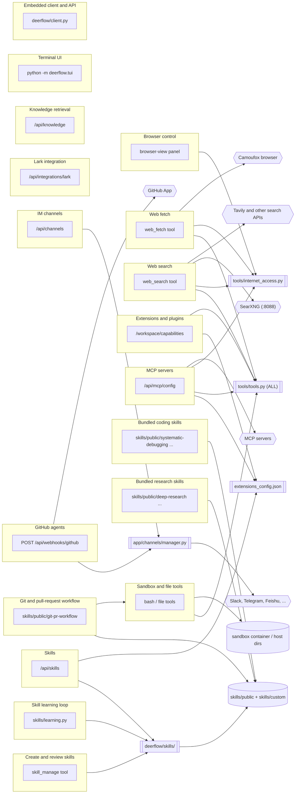

# Tools, skills and integrations

### Skills
What: load skills from skills/public and skills/custom into the agent, call them with /slash commands, browse and toggle them in the capability center, install from an archive and export custom skills.
Entry points: /workspace/capabilities, slash commands in the composer, /api/skills
Files: backend/packages/harness/deerflow/skills/**, backend/app/gateway/routers/skills.py, backend/app/gateway/skill_export.py, backend/packages/harness/deerflow/agents/middlewares/skill_activation_middleware.py, frontend/src/core/skills/**, frontend/src/components/workspace/capabilities/skill-gallery.tsx, frontend/src/components/workspace/skill-usage/**, frontend/src/components/workspace/slash-skill-chip.tsx, contracts/slash_skill_contract.json
Data: skills/public, skills/custom, extensions_config.json (enabled state)
External: none
Tests: backend/tests/test_lead_agent_skills.py, backend/tests/test_slash_skills.py, backend/tests/test_skills_bundled.py, backend/tests/test_skill_export.py, backend/tests/blocking_io/test_skills_install.py, frontend/tests/unit/core/skills/export.test.ts, frontend/tests/e2e/skills-settings.spec.ts

### Create and review skills
What: the agent writes and edits skills through skill_manage as reviewed mutations, and skill-creator, skill-reviewer and find-skills help author, review and discover them.
Entry points: skill_manage tool, review_skill_package tool, /api/skill-mutations, python -m deerflow.skills.review
Files: backend/packages/harness/deerflow/tools/skill_manage_tool.py, backend/packages/harness/deerflow/skills/mutations/**, backend/packages/harness/deerflow/skills/review/**, backend/app/gateway/routers/skill_mutations.py, backend/packages/harness/deerflow/tools/builtins/review_skill_package_tool.py, skills/public/skill-creator/**, skills/public/skill-reviewer/**, skills/public/find-skills/**, contracts/skill_review/**
Data: skill_mutations table, skills/custom
External: none
Tests: backend/tests/test_skill_manage_tool.py, backend/tests/test_skill_mutation_guard.py, backend/tests/test_skill_review_core.py, backend/tests/test_skill_reviewer_public_skill.py, tests/skills/test_skill_creator_frontmatter.py

### Skill learning loop
What: with skill_evolution on, a long run (or one that loaded a custom skill) gets one reminder before its final answer to save or patch a skill with skill_manage; every skill load is counted in a per-user ledger; a daily curator switches off agent-written skills nobody loaded for archive_unused_after_days.
Entry points: the end-of-run review, skill_manage tool, skill loads (read_file of a SKILL.md, slash activation)
Files: backend/packages/harness/deerflow/skills/learning.py, backend/packages/harness/deerflow/tools/skill_manage_tool.py, backend/packages/harness/deerflow/agents/middlewares/completion_review_middleware.py, backend/packages/harness/deerflow/agents/middlewares/skill_usage.py, backend/packages/harness/deerflow/config/skill_evolution_config.py
Data: the per-user skill ledger, per-user skill enabled state, skill history (.history/*.jsonl)
External: none
Tests: backend/tests/test_skill_learning_ledger.py, backend/tests/test_completion_review_middleware.py, backend/tests/test_skill_manage_tool.py

### Bundled research skills
What: the research, analysis and writing skills that ship in skills/public (deep research, GitHub research, data analysis, consulting analysis, paper and literature review, frontend and web design, Vercel deploy and others).
Entry points: the skills by name or slash command
Files: skills/public/deep-research/**, skills/public/github-deep-research/**, skills/public/data-analysis/**, skills/public/consulting-analysis/**, skills/public/academic-paper-review/**, skills/public/systematic-literature-review/**, skills/public/frontend-design/**, skills/public/web-design-guidelines/**, skills/public/vercel-deploy/**, skills/public/code-documentation/**, skills/public/bootstrap/**, skills/public/claude-to-deerflow/**, skills/public/surprise-me/**
Data: thread workspace
External: the services each skill names (GitHub, Vercel, ...)
Tests: tests/skills/test_data_analysis_json_export.py, tests/skills/test_github_deep_research.py, tests/skills/test_github_research_issues.py, backend/tests/test_skills_bundled.py, tests/skills/test_claude_to_deerflow.py

### Bundled coding skills
What: coding-discipline skills that ship in skills/public: systematic debugging, test-driven development, requesting code review, simplify code, spike, subagent-driven development, and repo-change-cycle (sets a repository up with a feature map and a three-level change cycle from the bundled setup brief).
Entry points: the skills by name or slash command
Files: skills/public/systematic-debugging/**, skills/public/test-driven-development/**, skills/public/requesting-code-review/**, skills/public/simplify-code/**, skills/public/spike/**, skills/public/subagent-driven-development/**, skills/public/repo-change-cycle/**, backend/packages/harness/deerflow/skills/describe.py
Data: thread workspace
External: none
Tests: tests/skills/test_coding_skills.py, backend/tests/test_change_cycle_doc.py, backend/tests/test_context_fit_critical.py

### Git and pull-request workflow
What: a bundled skill that takes a change in the sandbox through branch, commit, push and pull request.
Entry points: the git-pr-workflow skill
Files: skills/public/git-pr-workflow/**
Data: the cloned repository in the sandbox
External: GitHub (git remote, gh CLI)
Tests: tests/skills/test_git_pr_workflow.py

### MCP servers
What: connect MCP servers (shared or personal, with OAuth), expose their tools through deferred tool search, and follow long-running MCP tasks in the background tasks panel.
Entry points: capability center MCP manager, /api/mcp/config, /api/mcp/personal/config, /api/threads/{thread_id}/mcp-tasks
Files: backend/packages/harness/deerflow/mcp/**, backend/app/gateway/routers/mcp.py, backend/app/gateway/routers/personal_mcp.py, backend/app/gateway/routers/mcp_tasks.py, backend/app/mcp_tasks/**, backend/packages/harness/deerflow/tools/builtins/tool_search.py, backend/packages/harness/deerflow/tools/builtins/background_tasks_tool.py, frontend/src/core/mcp/**, frontend/src/components/workspace/capabilities/mcp-plugin-manager.tsx, frontend/src/core/background-tasks/**
Data: extensions_config.json (mcpServers), mcp_oauth_tokens and mcp_tasks tables
External: MCP servers
Tests: backend/tests/test_mcp_client_config.py, backend/tests/test_mcp_cache.py, backend/tests/test_personal_mcp.py, backend/tests/test_tool_search.py, backend/tests/test_run_worker_mcp_tasks.py, frontend/tests/unit/core/mcp/api.test.ts, frontend/tests/e2e/mcp-settings.spec.ts

### IM channels
What: talk to the agent from Slack, Telegram, Feishu, DingTalk, Discord, QQ, WeChat, WeCom or Buzz; connections are managed in Settings: Channels and replies stream back into the chat.
Entry points: Settings: Channels, /api/channels, the IM platforms
Files: backend/app/channels/**, backend/app/gateway/routers/channels.py, backend/app/gateway/routers/channel_connections.py, backend/app/gateway/routers/im_notification_preferences.py, backend/packages/harness/deerflow/persistence/channel_connections/**, frontend/src/components/workspace/channels/**, frontend/src/core/channels/**, frontend/src/components/workspace/settings/channels-settings-page.tsx
Data: channel_connections, channel_runtime_configs, channel_thread_bindings and channel_leases tables
External: Slack, Telegram, Feishu/Lark, DingTalk, Discord, QQ, WeChat, WeCom and Nostr (Buzz) APIs
Tests: backend/tests/test_channels_router.py, backend/tests/test_channel_connections_router.py, backend/tests/test_slack_channel_lifecycle.py, backend/tests/test_telegram_reply_threads.py, backend/tests/test_feishu_parser.py, frontend/tests/e2e/channels.spec.ts

### GitHub agents
What: a GitHub App delivers issue and pull-request events by webhook, and agents answer and act on them under configured triggers.
Entry points: POST /api/webhooks/github
Files: backend/app/gateway/github/**, backend/app/gateway/routers/github_webhooks.py, backend/app/channels/github.py, backend/packages/harness/deerflow/persistence/webhook_delivery/**
Data: webhook_delivery table
External: GitHub App API
Tests: backend/tests/test_github_webhooks.py, backend/tests/test_github_dispatcher.py, backend/tests/test_github_channel.py, backend/tests/test_github_triggers.py

### Lark integration
What: install and authorize the Lark (Feishu) CLI so the agent can use Lark documents and messages through a credential broker.
Entry points: capability center Lark settings, /api/integrations/lark
Files: backend/packages/harness/deerflow/integrations/**, backend/app/gateway/routers/integrations.py, frontend/src/core/integrations/**, frontend/src/components/workspace/capabilities/lark-plugin-settings.tsx, docker/lark-cli-broker/**, docker/lark-cli-init/**
Data: Lark credentials in the broker
External: Lark/Feishu open platform
Tests: backend/tests/test_lark_broker.py, backend/tests/test_lark_auth_singleflight.py, frontend/tests/unit/core/integrations/lark/api.test.ts, frontend/tests/e2e/integrations.spec.ts

### Extensions and plugins
What: operator-installed extension packages add tools, pages, artifact previews and mentions (a plugin tool can hand a file to its conversation), browsed in the capability center.
Entry points: /workspace/capabilities, /workspace/extensions/[namespace]/[surface_id], /api/plugins, /api/capabilities, plugins: in config.yaml
Files: backend/packages/harness/deerflow/extensions/**, backend/packages/extension-api/**, backend/packages/harness/deerflow/capabilities/**, backend/app/gateway/routers/plugins.py, backend/app/gateway/routers/capabilities.py, backend/app/gateway/extension_artifacts.py, frontend/src/core/extensions/**, frontend/src/components/workspace/capabilities/**, frontend/src/components/workspace/plugin-surfaces.tsx, examples/**
Data: extension_leases table, extension state
External: none
Tests: backend/tests/test_extension_loader.py, backend/tests/test_extension_manager.py, backend/tests/test_plugin_tools.py, backend/tests/test_capability_api.py, backend/tests/test_extension_api_contracts.py, frontend/tests/unit/core/extensions/actions.dom.test.tsx, frontend/tests/e2e/capability-center.spec.ts

### Web search
What: web_search is a pluggable dispatcher, Tavily first with the bundled self-hosted SearXNG behind it (or SearXNG alone with no key), that reports a blocked engine as an error instead of an empty result.
Entry points: web_search and image_search tools
Files: backend/packages/harness/deerflow/community/web_search/**, backend/packages/harness/deerflow/community/searxng/**, backend/packages/harness/deerflow/community/tavily/**, backend/packages/harness/deerflow/community/ddg_search/**, scripts/detect_searxng.py, scripts/searxng.sh, docker/searxng/**, frontend/src/components/workspace/citations/**
Data: none
External: SearXNG on loopback port 8088, Tavily and other search APIs
Tests: backend/tests/test_web_search_dispatcher.py, backend/tests/test_searxng_client.py, backend/tests/test_detect_searxng.py, backend/tests/test_tavily_tools.py, backend/tests/test_search_fetch_defaults.py, frontend/tests/e2e/web-search-results.spec.ts, backend/tests/test_community_config_bool.py, backend/tests/test_community_config_int.py

### Web fetch
What: web_fetch reads pages through a local Camoufox stealth browser by default (geoip, humanize, block_webrtc), with Jina and other readers as alternatives.
Entry points: web_fetch tool
Files: backend/packages/harness/deerflow/community/web_fetch/**, backend/packages/harness/deerflow/community/camoufox_fetch/**, backend/packages/harness/deerflow/community/jina_ai/**, backend/packages/harness/deerflow/community/url_safety.py, backend/packages/harness/deerflow/utils/readability.py, scripts/ensure_camoufox.py
Data: none
External: the fetched sites, Jina reader when configured
Tests: backend/tests/test_web_fetch_dispatcher.py, backend/tests/test_camoufox_fetch.py, backend/tests/test_camoufox_stealth_options.py, backend/tests/test_ensure_camoufox.py, backend/tests/test_camoufox_runtime_deps.py, backend/tests/test_jina_client.py, backend/tests/test_community_config_bool.py, backend/tests/test_community_config_int.py

### Sandbox and file tools
What: bash and file tools run in a local or per-thread container sandbox (also E2B, BoxLite, OpenSandbox, Tenki), with clone-and-run of repos, exposed ports, debuggers, optional KVM and private GitHub access.
Entry points: bash, read_file, write_file, str_replace, ls and search tools, make sandbox-enable, repo-runner skill
Files: backend/packages/harness/deerflow/sandbox/**, backend/packages/harness/deerflow/community/aio_sandbox/**, backend/packages/harness/deerflow/config/sandbox_config.py, scripts/sandbox_toggle.py, scripts/sandbox-mode.sh, scripts/setup-sandbox.sh, docker/docker-compose.sandbox.yml, docker/provisioner/**, skills/public/repo-runner/**
Data: thread workspace, uploads and outputs directories, sandbox containers
External: Docker or a remote sandbox provider
Tests: backend/tests/test_sandbox_tools_security.py, backend/tests/test_local_sandbox_command_timeout.py, backend/tests/test_aio_sandbox_provider.py, backend/tests/test_aio_sandbox_git_credentials.py, backend/tests/test_sandbox_toggle.py, backend/tests/test_docker_sandbox_mode_detection.py, backend/tests/test_provisioner_mount_contract.py

### Browser control
What: the agent drives a real browser in the sandbox while you watch (and can take over) in the live browser view.
Entry points: browser automation tools, browser view panel, /api/threads/{thread_id}/browser
Files: backend/packages/harness/deerflow/community/browser_automation/**, backend/app/gateway/routers/browser.py, backend/app/gateway/browser_capability.py, frontend/src/components/workspace/browser-view/**
Data: browser outputs in the thread directory
External: the sites visited
Tests: backend/tests/test_browser_router.py, backend/tests/test_browser_automation.py, frontend/tests/unit/components/workspace/browser-view/browser-view-panel.dom.test.tsx, frontend/tests/e2e/browser-feature.spec.ts

### Knowledge retrieval
What: read-only knowledge sources (LightRAG, RAGFlow, WeKnora and knowledge extensions) that the agent searches and cites, scoped per agent or per run.
Entry points: knowledge scope selector, /api/knowledge, knowledge tools
Files: backend/packages/harness/deerflow/knowledge/**, backend/packages/harness/deerflow/community/lightrag/**, backend/packages/harness/deerflow/community/ragflow/**, backend/app/gateway/routers/knowledge.py, backend/app/gateway/knowledge_scope_admission.py, frontend/src/core/knowledge/**, frontend/src/components/workspace/knowledge-scope-selector.tsx, examples/deerflow-extension-knowledge/**, contracts/knowledge_sources.v1.json
Data: none (sources are external)
External: LightRAG, RAGFlow, WeKnora servers
Tests: backend/tests/test_knowledge_router.py, backend/tests/test_knowledge_contract.py, backend/tests/test_lightrag_tools.py, backend/tests/test_ragflow_tools.py, frontend/tests/e2e/knowledge-scope.spec.ts

### Terminal UI
What: chat with DeerFlow from a terminal with a composer, command palette and input history.
Entry points: python -m deerflow.tui
Files: backend/packages/harness/deerflow/tui/**
Data: TUI session files
External: LLM providers (through the embedded client)
Tests: backend/tests/test_tui_app.py, backend/tests/test_tui_cli.py, backend/tests/test_tui_composer.py

### Embedded client and API
What: use the agent from Python (DeerFlowClient), from LangGraph Studio and LangGraph-compatible assistants routes, or over the Gateway API with personal access tokens.
Entry points: deerflow.client.DeerFlowClient, /api/assistants, backend/langgraph.json
Files: backend/packages/harness/deerflow/client.py, backend/app/gateway/langgraph_studio.py, backend/app/gateway/routers/assistants_compat.py, backend/langgraph.json, backend/packages/harness/deerflow/persistence/personal_access_tokens/**
Data: personal_access_tokens table
External: LLM providers
Tests: backend/tests/test_client.py, backend/tests/test_client_e2e.py, backend/tests/test_langgraph_studio_routes.py, backend/tests/test_pat_auth.py
