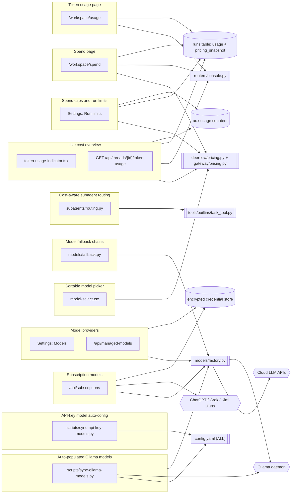

# Models and cost

### Auto-populated Ollama models
What: config.yaml syncs from your ollama pull list on every launch, with capabilities detected and each model's context window sized to your GPU (or the GPU memory entered in Settings: Models).
Entry points: make dev / make start / make up (launch-time sync), python3 scripts/sync-ollama-models.py
Files: scripts/sync-ollama-models.py, backend/packages/harness/deerflow/config/ollama_config.py, backend/packages/harness/deerflow/models/factory.py, frontend/src/components/workspace/settings/model-settings-page.tsx
Data: writes the models: block of config.yaml
External: Ollama daemon (/api/tags, /api/show)
Tests: backend/tests/test_sync_ollama_models.py, backend/tests/test_ollama_lifecycle.py, backend/tests/test_docker_ollama_sync.py, backend/tests/test_context_fit_critical.py

### API-key model auto-config
What: a cloud API key in .env uncomments the matching model block in config.yaml on the next launch, one flagship per lab plus a routed OpenRouter set.
Entry points: launch-time sync, python3 scripts/sync-api-key-models.py
Files: scripts/sync-api-key-models.py, config.example.yaml, scripts/wizard/providers.py
Data: writes the models: block of config.yaml
External: none (keys are only detected)
Tests: backend/tests/test_sync_api_key_models.py, backend/tests/test_config_integrity.py

### Subscription models
What: connect a ChatGPT plan in the browser, sign in to Grok with a device code or add a Kimi Code key; the plan's models populate the picker, with encrypted server-side credentials.
Entry points: Settings: Models: Subscriptions, /api/subscriptions
Files: backend/app/gateway/routers/subscriptions.py, backend/packages/harness/deerflow/models/subscriptions.py, backend/packages/harness/deerflow/models/subscription_providers.py, backend/packages/harness/deerflow/models/chatgpt_subscription_auth.py, backend/packages/harness/deerflow/models/openai_codex_provider.py, frontend/src/components/workspace/settings/subscription-settings.tsx, frontend/src/core/models/subscriptions.ts
Data: encrypted per-user credentials, discovered model list
External: ChatGPT, xAI Grok and Kimi Code plan endpoints
Tests: backend/tests/test_subscriptions.py, backend/tests/test_subscription_providers.py, backend/tests/test_chatgpt_subscription_auth.py, frontend/tests/unit/components/workspace/settings/model-settings-page.dom.test.tsx, frontend/tests/e2e/subscription-models.spec.ts

### Model providers
What: talk to any configured LLM (OpenAI-compatible, Claude, vLLM, MindIE, DeepSeek and other patched providers) and add or edit models from Settings: Models through managed models and the model catalog.
Entry points: Settings: Models, /api/managed-models, POST /api/models/resolve
Files: backend/packages/harness/deerflow/models/**, backend/app/gateway/routers/managed_models.py, backend/app/gateway/routers/models.py, backend/app/gateway/model_discovery.py, backend/packages/harness/deerflow/config/managed_models.py, frontend/src/core/models/**, frontend/src/components/workspace/settings/model-settings-page.tsx, frontend/src/components/workspace/settings/model-catalog-dialog.tsx, docker/docker-compose.cli-auth.yaml
Data: managed model entries, encrypted provider credentials
External: LLM provider APIs
Tests: backend/tests/test_model_factory.py, backend/tests/test_managed_models.py, backend/tests/test_claude_provider_thinking.py, backend/tests/test_preserved_thinking.py, backend/tests/test_patched_openai.py, backend/tests/test_vllm_provider.py, frontend/tests/unit/core/models/api.test.ts, frontend/tests/e2e/model-management.spec.ts

### Sortable model picker
What: every screen that picks a model uses one picker: sort by name or price, group by provider, search, prices in one column and a local model's weights and window under its id.
Entry points: composer model picker, every settings model dropdown
Files: frontend/src/components/workspace/model-select.tsx, frontend/src/components/workspace/model-picker-content.tsx, frontend/src/components/workspace/model-picker-controls.tsx, frontend/src/components/ai-elements/model-selector.tsx, frontend/src/core/models/sorting.ts, frontend/src/core/models/favorites.ts, backend/packages/harness/deerflow/pricing.py
Data: per-browser picker preferences
External: none
Tests: frontend/tests/unit/core/models/sorting.test.ts, frontend/tests/unit/components/workspace/model-select.dom.test.tsx, frontend/tests/unit/components/workspace/model-picker-sites.test.ts, backend/tests/test_model_picker_metadata.py, frontend/tests/e2e/model-catalog.spec.ts

### Model fallback chains
What: a retryable failure (daemon down, context overflow, no tool support, provider 5xx) degrades to the next model listed under fallback; cancels, spend caps and guardrail refusals never fall back.
Entry points: fallback: on a model entry in config.yaml
Files: backend/packages/harness/deerflow/models/fallback.py, backend/packages/harness/deerflow/config/model_fallback_config.py, backend/packages/harness/deerflow/models/factory.py, backend/packages/harness/deerflow/agents/middlewares/llm_error_handling_middleware.py
Data: none
External: LLM providers
Tests: backend/tests/test_model_fallback.py, backend/tests/test_llm_error_handling_middleware.py

### Cost-aware subagent routing
What: a policy sends delegated subtasks to the cheapest model that can do them, never one lacking the tools, vision or context window; off until you write a policy.
Entry points: model_routing: in config.yaml, task tool
Files: backend/packages/harness/deerflow/subagents/routing.py, backend/packages/harness/deerflow/config/model_routing_config.py, backend/packages/harness/deerflow/tools/builtins/task_tool.py, frontend/src/components/workspace/messages/subtask-card.tsx, frontend/src/core/tasks/lifecycle.ts
Data: none
External: none
Tests: backend/tests/test_model_routing.py, frontend/tests/unit/core/tasks/lifecycle.test.ts

### Live cost overview
What: an estimated cost per conversation in the chat header, priced per model from config.yaml and stamped on each run, including auxiliary calls, replaced turns and a per-step price graph.
Entry points: chat header cost button, GET /api/threads/{thread_id}/token-usage
Files: frontend/src/components/workspace/token-usage-indicator.tsx, frontend/src/components/workspace/cost-per-step-chart.tsx, frontend/src/core/threads/token-usage.ts, frontend/src/core/threads/cost-chart.ts, backend/app/gateway/pricing.py, backend/packages/harness/deerflow/pricing.py, backend/packages/harness/deerflow/runtime/aux_usage.py, backend/packages/harness/deerflow/runtime/aux_usage_store.py, backend/packages/harness/deerflow/agents/middlewares/token_usage_middleware.py, backend/app/gateway/edit_version_family.py
Data: runs table (token usage and pricing_snapshot), auxiliary usage counters
External: none
Tests: backend/tests/test_pricing.py, backend/tests/test_thread_token_usage.py, backend/tests/test_thread_step_costs.py, backend/tests/test_run_pricing_snapshot.py, backend/tests/test_thread_cost_robustness.py, backend/tests/test_model_price_fields.py, backend/tests/test_aux_usage.py, frontend/tests/unit/core/threads/token-usage.test.ts, frontend/tests/unit/components/workspace/cost-per-step-chart.dom.test.tsx

### Spend caps and run limits
What: a daily, weekly or monthly spend cap in your currency (warn, then refuse), plus the tool-call loop limits, token budgets and background step limit, all editable under Settings: Run limits.
Entry points: Settings: Run limits, spend_budget: in config.yaml, HTTP 402 at run admission
Files: backend/packages/harness/deerflow/agents/middlewares/spend_budget_middleware.py, backend/packages/harness/deerflow/config/spend_budget_config.py, backend/packages/harness/deerflow/config/run_limit_overrides.py, backend/packages/harness/deerflow/runtime/spend_window.py, backend/app/gateway/spend_budget.py, backend/packages/harness/deerflow/agents/middlewares/loop_detection_middleware.py, backend/packages/harness/deerflow/agents/middlewares/token_budget_middleware.py, frontend/src/components/workspace/settings/run-limits-settings-page.tsx, frontend/src/core/settings/run-limits.ts
Data: runs table and auxiliary counters (window aggregation), run limit overrides file
External: none
Tests: backend/tests/test_spend_budget.py, backend/tests/test_spend_budget_config.py, backend/tests/test_spend_budget_middleware.py, backend/tests/test_run_limit_overrides.py, backend/tests/test_loop_detection_middleware.py, frontend/tests/unit/components/workspace/settings/run-limits-settings-page.dom.test.tsx, frontend/tests/unit/core/settings/run-limits.test.ts

### Spend page
What: where the money went over 7, 30 or 90 days, broken down by model, conversation and feature, unpriced models named and sorted last.
Entry points: /workspace/spend, GET /api/console/spend
Files: frontend/src/app/workspace/spend/page.tsx, frontend/src/core/spend/**, backend/app/gateway/routers/console.py, backend/packages/harness/deerflow/runtime/spend_window.py
Data: runs table, auxiliary usage counters
External: none
Tests: backend/tests/test_console_router.py

### Token usage page
What: token totals by day, model and run, each split into input and output with the cache-hit part of input marked.
Entry points: /workspace/usage, GET /api/console/usage, GET /api/console/runs
Files: frontend/src/app/workspace/usage/page.tsx, frontend/src/components/workspace/usage/**, frontend/src/core/usage/**, backend/app/gateway/routers/console.py, backend/packages/harness/deerflow/agents/middlewares/token_usage_middleware.py
Data: runs table
External: none
Tests: backend/tests/test_console_router.py, backend/tests/test_token_usage_by_model.py, frontend/tests/unit/core/usage/dashboard.dom.test.tsx, frontend/tests/unit/core/usage/format.test.ts, frontend/tests/e2e/usage-dashboard.spec.ts
