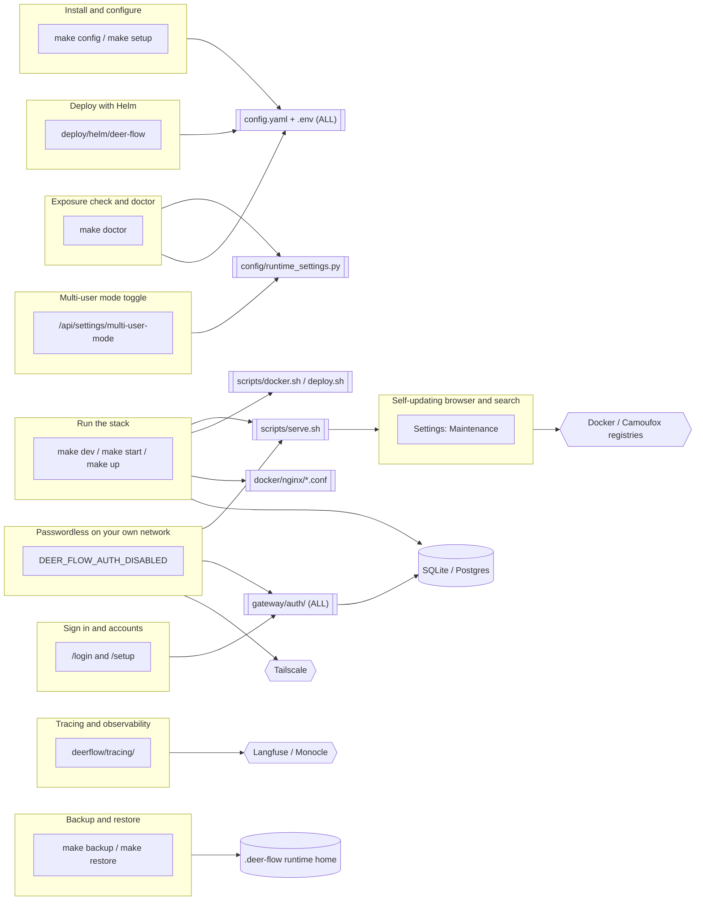

# Install, run and operate

### Install and configure
What: first setup and upgrades: make config and the setup wizard write config.yaml and .env, make config-upgrade adds new keys without touching yours, and config validation rejects duplicate or typo keys.
Entry points: make config, make setup, make config-upgrade, make check, make install
Files: scripts/setup_wizard.py, scripts/wizard/**, scripts/configure.py, scripts/config_upgrade.py, scripts/config-upgrade.sh, scripts/check.py, scripts/detect_uv_extras.py, config.example.yaml, backend/packages/harness/deerflow/config/app_config.py, backend/scripts/migrate_user_isolation.py
Data: config.yaml, .env, extensions_config.json
External: none
Tests: backend/tests/test_setup_wizard.py, backend/tests/test_configure_script.py, backend/tests/test_config_upgrade_script.py, backend/tests/test_config_version.py, backend/tests/test_serve_config_seed.py, backend/tests/test_detect_uv_extras.py

### Run the stack
What: start the Gateway, frontend and nginx locally or in Docker (dev with hot reload, or production images), loopback-only by default, with the Arch/CachyOS nginx and Ollama fixes built in.
Entry points: make dev, make start, make up, make docker-start, http://localhost:2026
Files: scripts/serve.sh, scripts/docker.sh, scripts/deploy.sh, scripts/nginx.sh, scripts/backend-python.sh, docker/docker-compose.yaml, docker/docker-compose-dev.yaml, docker/dev-entrypoint.sh, docker/nginx/**, backend/Dockerfile, frontend/Dockerfile, frontend/scripts/dev.mjs, backend/app/gateway/health.py, scripts/docker_launch_lib.sh
Data: .deer-flow runtime home, logs/
External: Docker
Tests: backend/tests/test_serve_gateway_startup_timeout.py, backend/tests/test_compose_default_bind_host.py, backend/tests/test_nginx_browser_websocket.py, backend/tests/test_nginx_local_temp_paths.py, backend/tests/test_dev_stack_host_user.py, frontend/tests/unit/scripts/dev.test.ts, backend/tests/test_nginx_route_parity.py

### Deploy with Helm
What: deploy the Gateway, frontend, nginx, provisioner, Postgres and Redis to Kubernetes from the bundled chart.
Entry points: helm install deploy/helm/deer-flow
Files: deploy/helm/**
Data: Postgres and Redis stateful sets, the home PVC
External: Kubernetes
Tests: backend/tests/test_helm_credentials_key.py, backend/tests/test_helm_init_containers.py, backend/tests/test_helm_image_pull_secrets.py

### Passwordless on your own network
What: make dev and make start come up with no login wall so phones and laptops reach it over the LAN or Tailscale, with private-LAN and tailnet dev origins allowed and tailnet reach detected rather than configured.
Entry points: DEER_FLOW_AUTH_DISABLED (defaults to 1 for local launches), DEER_FLOW_DEV_ALLOWED_ORIGINS
Files: backend/app/gateway/auth_disabled.py, frontend/src/core/auth/auth-disabled-user.ts, frontend/src/dev-origins.js, scripts/detect_tailscale.py, scripts/tailscale_lib.sh, docker/docker-compose.tailscale.yaml, docker/docker-compose.loopback.yaml, scripts/serve.sh, scripts/docker_launch_lib.sh
Data: none
External: Tailscale
Tests: backend/tests/test_serve_auth_default.py, backend/tests/test_deploy_auth_default.py, backend/tests/test_detect_tailscale.py, backend/tests/test_docker_dev_tailnet.py, backend/tests/test_deploy_loopback_cobind.py, frontend/tests/unit/dev-origins.test.ts

### Sign in and accounts
What: local accounts with first-run admin setup, OIDC single sign-on, personal access tokens, login throttling and an admin user list.
Entry points: /login, /setup, /auth/callback, /api/v1/auth, /api/v1/admin/users
Files: backend/app/gateway/auth/**, backend/app/gateway/routers/auth.py, backend/app/gateway/routers/admin_users.py, backend/app/gateway/auth_middleware.py, backend/packages/harness/deerflow/authz/**, frontend/src/app/(auth)/**, frontend/src/core/auth/**, frontend/src/components/auth/**, frontend/src/components/workspace/settings/account-settings-page.tsx
Data: users, login_throttle and personal_access_tokens tables, session cookies
External: OIDC identity provider when configured
Tests: backend/tests/test_auth_middleware.py, backend/tests/test_oidc_auth.py, backend/tests/test_admin_users_router.py, backend/tests/test_login_throttle_store.py, frontend/tests/unit/core/auth/setup.test.ts, frontend/tests/unit/app/login-account-disabled.dom.test.tsx

### Multi-user mode toggle
What: on by default (each login sees only its own chats); turn it off to merge every conversation into one shared workspace.
Entry points: Settings: Account, GET/PUT /api/settings/multi-user-mode
Files: backend/packages/harness/deerflow/config/runtime_settings.py, backend/app/gateway/routers/settings.py, frontend/src/core/settings/multi-user-mode.ts, frontend/src/components/workspace/settings/account-settings-page.tsx
Data: runtime_settings.json, owner scope of thread_meta and runs reads
External: none
Tests: backend/tests/test_multi_user_mode.py, frontend/tests/unit/core/settings/multi-user-mode.test.ts

### Exposure check and doctor
What: make doctor checks the install and prints the combined deployment posture (passwordless auth, multi-user mode, bind address); make support-bundle collects a redacted diagnosis.
Entry points: make doctor, make support-bundle
Files: scripts/doctor.py, scripts/exposure.py, scripts/support_bundle.py
Data: reads .env, config.yaml and runtime_settings.json
External: none
Tests: backend/tests/test_exposure.py, backend/tests/test_doctor.py, backend/tests/test_doctor_script.py, backend/tests/test_support_bundle.py

### Backup and restore
What: make backup snapshots the whole .deer-flow home as one timestamped archive and make restore puts it back; credentials are excluded unless INCLUDE_SECRETS=1.
Entry points: make backup, make restore
Files: scripts/backup.py
Data: the .deer-flow runtime home
External: none
Tests: backend/tests/test_backup.py

### Self-updating browser and search
What: Camoufox and the SearXNG image refresh themselves on launch (throttled daily) or by a systemd user timer, and Settings: Maintenance has an Update dependencies button.
Entry points: launch-time updater, make auto-update-install, Settings: Maintenance, POST /api/settings/update-dependencies
Files: scripts/update_camoufox_searxng.py, scripts/install_auto_update.py, scripts/searxng.sh, backend/app/gateway/dependency_update.py, frontend/src/components/workspace/settings/maintenance-settings-page.tsx, frontend/src/core/settings/dependency-update.ts
Data: Camoufox install, SearXNG container image
External: Camoufox release downloads, container registry
Tests: backend/tests/test_update_camoufox_searxng.py, backend/tests/test_install_auto_update.py, backend/tests/test_searxng_update_script.py, backend/tests/test_dependency_update.py

### Tracing and observability
What: trace every run with a trace id through Langfuse or Monocle when tracing is configured.
Entry points: tracing: in config.yaml
Files: backend/packages/harness/deerflow/tracing/**, backend/packages/harness/deerflow/trace_context.py, backend/app/gateway/trace_middleware.py
Data: none
External: Langfuse or Monocle
Tests: backend/tests/test_tracing_factory.py, backend/tests/test_tracing_config.py, backend/tests/test_monocle_tracing.py, backend/tests/test_worker_langfuse_metadata.py
