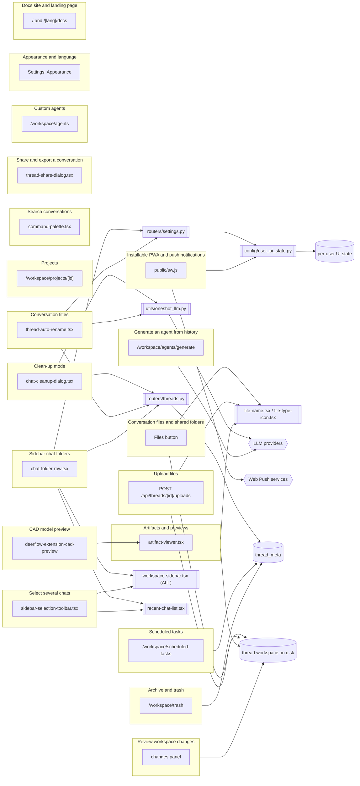

# Sidebar and workspace

### Sidebar chat folders
What: the chat list is a tree of folders and subfolders up to five levels; a filed chat lives inside its folder, chats and folders drag around, and the virtualized list scrolls to the right rows.
Entry points: sidebar New folder, drag and drop, GET/PUT /api/settings/chat-folders
Files: frontend/src/components/workspace/chat-folder-row.tsx, frontend/src/components/workspace/recent-chat-list.tsx, frontend/src/components/workspace/thread-list-virtualizer.tsx, frontend/src/components/workspace/workspace-nav-chat-list.tsx, frontend/src/core/threads/chat-folders.ts, frontend/src/core/threads/use-chat-folders.ts, frontend/src/core/threads/dnd.ts, frontend/src/core/threads/thread-list-model.ts, backend/app/gateway/routers/settings.py, backend/packages/harness/deerflow/config/user_ui_state.py
Data: per-user UI state (folder tree), thread_meta
External: none
Tests: backend/tests/test_chat_folders_settings_router.py, backend/tests/test_user_ui_state.py, frontend/tests/unit/core/threads/chat-folders.test.ts, frontend/tests/unit/core/threads/use-chat-folders.dom.test.tsx, frontend/tests/unit/components/workspace/thread-list-scroll-margin.dom.test.tsx, frontend/tests/e2e/sidebar-chat-folders.spec.ts

### Select several chats
What: Select puts a checkbox on every sidebar row (Shift-click for a range); move the batch into a folder or a new folder, archive or delete it.
Entry points: sidebar Select button, chat row menu
Files: frontend/src/components/workspace/sidebar-selection.tsx, frontend/src/components/workspace/sidebar-selection-toolbar.tsx, frontend/src/components/workspace/thread-bulk-delete-dialog.tsx, frontend/src/components/workspace/workspace-sidebar-frame.tsx, frontend/src/core/threads/thread-selection.ts, frontend/src/core/threads/bulk.ts, frontend/src/core/threads/archive.ts
Data: thread_meta, per-user UI state
External: none
Tests: frontend/tests/unit/core/threads/thread-selection.test.ts, frontend/tests/unit/core/threads/bulk-thread-actions.dom.test.tsx, frontend/tests/unit/components/workspace/sidebar-selection.dom.test.tsx, frontend/tests/e2e/sidebar-multi-select.spec.ts

### Clean-up mode
What: a model you pick reads the selected conversations (or your 200 most recent), suggests clearer titles and files them into folders, shown as a preview you accept.
Entry points: Clean up... in the selection toolbar, POST /api/threads/{thread_id}/organize/suggest, POST /api/chat-organize/consolidate
Files: frontend/src/components/workspace/chat-cleanup/**, frontend/src/core/threads/chat-organize.ts, backend/app/gateway/routers/chat_organize.py, backend/packages/harness/deerflow/utils/chat_organize.py, backend/packages/harness/deerflow/runtime/aux_usage.py
Data: thread_meta titles, per-user folder tree, auxiliary usage counters
External: LLM providers
Tests: backend/tests/test_chat_organize.py, backend/tests/test_chat_organize_router.py, frontend/tests/unit/core/threads/chat-organize.test.ts, frontend/tests/unit/components/workspace/chat-cleanup/chat-cleanup-dialog.dom.test.tsx, frontend/tests/e2e/chat-cleanup.spec.ts

### Conversation titles
What: automatic titles that cost no model call by default (or use a cheap model, or are off), saved to your account, plus an Auto rename button that names a chat from what is in it now.
Entry points: Settings: Conversation titles, chat header Auto rename, POST /api/threads/{thread_id}/title/suggest
Files: backend/packages/harness/deerflow/agents/middlewares/title_middleware.py, backend/packages/harness/deerflow/config/title_config.py, backend/packages/harness/deerflow/utils/title_transcript.py, backend/app/gateway/routers/threads.py, backend/app/gateway/routers/settings.py, frontend/src/components/workspace/thread-auto-rename.tsx, frontend/src/components/workspace/thread-title.tsx, frontend/src/components/workspace/settings/auto-title-settings-page.tsx, frontend/src/core/settings/auto-title-sync.ts, frontend/src/core/threads/auto-rename.ts
Data: thread_meta title, per-user UI state (title preference)
External: LLM providers (when a title model is set)
Tests: backend/tests/test_auto_title_preference.py, backend/tests/test_auto_title_settings_router.py, backend/tests/test_title_middleware_core_logic.py, backend/tests/test_thread_title_suggest.py, frontend/tests/unit/core/threads/auto-title.test.ts, frontend/tests/unit/components/workspace/thread-auto-rename.dom.test.tsx, frontend/tests/e2e/auto-title-settings.spec.ts

### Conversation files and shared folders
What: a Files explorer per conversation (workspace, uploads, outputs) and a record of which conversations wrote to a shared sandbox mount, with an edit log and an orphan offer on delete.
Entry points: chat header Files button, GET /api/threads/{thread_id}/files, /api/folder-ledger
Files: backend/app/gateway/routers/thread_files.py, backend/app/gateway/routers/folder_ledger.py, backend/packages/harness/deerflow/folder_ledger/**, backend/packages/harness/deerflow/agents/middlewares/folder_ledger_middleware.py, frontend/src/components/workspace/thread-files/**, frontend/src/components/workspace/folder-ledger/**, frontend/src/core/thread-files/**, frontend/src/core/folder-ledger/**
Data: thread workspace on disk, folder_ledger table
External: none
Tests: backend/tests/test_thread_files_router.py, backend/tests/test_folder_ledger_middleware.py, backend/tests/test_folder_ledger_router.py, frontend/tests/unit/components/workspace/thread-files/thread-shared-folders.dom.test.tsx, frontend/tests/e2e/thread-files.spec.ts, frontend/tests/e2e/folder-ledger.spec.ts

### Upload files
What: attach files to a message; PDF, DOCX, PPTX and XLSX uploads are converted to Markdown (pymupdf4llm) so the agent can read them.
Entry points: composer attachment button, POST /api/threads/{thread_id}/uploads
Files: backend/app/gateway/routers/uploads.py, backend/app/gateway/upload_ingestion.py, backend/packages/harness/deerflow/uploads/**, backend/packages/harness/deerflow/agents/middlewares/uploads_middleware.py, backend/packages/harness/deerflow/utils/file_conversion.py, frontend/src/core/uploads/**, frontend/src/components/workspace/input-attachment.tsx
Data: thread uploads directory
External: none
Tests: backend/tests/test_uploads_router.py, backend/tests/test_uploads_manager.py, backend/tests/test_uploads_middleware_core_logic.py, frontend/tests/unit/core/uploads/api.test.ts, frontend/tests/e2e/file-transfer.spec.ts

### Artifacts and previews
What: files the agent presents open in the artifact panel with previews for Markdown, code, tables, images and, through preview extensions, Word, Excel and PowerPoint (office preview) and GLB and STL models (CAD model preview), and download as files or an archive; a file over the 25 MiB preview limit says so and offers the download.
Entry points: artifact panel, /artifacts/view, GET /api/threads/{thread_id}/artifacts/{path}
Files: backend/app/gateway/routers/artifacts.py, backend/app/gateway/artifact_archive.py, backend/packages/harness/deerflow/tools/builtins/present_file_tool.py, backend/packages/harness/deerflow/agents/middlewares/artifact_capture_middleware.py, frontend/src/components/workspace/artifacts/**, frontend/src/core/artifacts/**, frontend/src/app/artifacts/**, examples/deerflow-extension-office-preview/**
Data: thread outputs directory
External: none
Tests: backend/tests/test_artifacts_router.py, backend/tests/test_artifact_capture_middleware.py, backend/tests/test_artifact_archive.py, frontend/tests/unit/core/artifacts/api.test.ts, frontend/tests/unit/core/artifacts/binary-preview.test.ts, frontend/tests/unit/components/workspace/artifacts/plugin-artifact-preview.dom.test.tsx, frontend/tests/e2e/artifact-preview.spec.ts, frontend/tests/e2e/office-preview-navigation.spec.ts, frontend/tests/e2e/cad-preview.spec.ts

### CAD model preview
What: a `.glb` or `.stl` file, the CAD module's output among them, opens as a model you can rotate in the artifact panel, the reader and the Files view, with its bounding box in millimetres and no motion of its own; a bundled browser extension (three.js) parses each file in a Worker that checks every count before it allocates, and the original still downloads.
Entry points: artifact panel, /artifacts/view, the Files view; make extension-disable NAME=cad-preview
Files: examples/deerflow-extension-cad-preview/**, backend/extensions/sources/deerflow-extension-cad-preview/**
Data: thread outputs directory (read through the artifact route)
External: none (three.js is bundled; nothing is fetched from a CDN)
Tests: examples/deerflow-extension-cad-preview/tests/glb.test.mjs, examples/deerflow-extension-cad-preview/tests/stl.test.mjs, examples/deerflow-extension-cad-preview/tests/mesh.test.mjs, examples/deerflow-extension-cad-preview/tests/worker-client.test.mjs, examples/deerflow-extension-cad-preview/tests/test_registration.py, backend/tests/test_bundled_cad_preview_extension.py, frontend/tests/e2e/cad-preview.spec.ts

### Projects
What: group conversations into a project with its own instructions, memory and a document shelf the agent can search.
Entry points: /workspace/projects/[id], /api/projects, /api/projects/{project_id}/documents
Files: backend/app/gateway/routers/projects.py, backend/app/gateway/routers/project_documents.py, backend/app/gateway/routers/project_thread_files.py, backend/packages/harness/deerflow/projects/**, frontend/src/components/workspace/projects/**, frontend/src/core/projects/**, frontend/src/app/workspace/projects/**
Data: projects and project document tables
External: none
Tests: backend/tests/test_projects_router.py, backend/tests/test_project_document_search.py, frontend/tests/unit/app/projects-page.dom.test.tsx, frontend/tests/unit/core/projects/documents-api.test.ts, frontend/tests/e2e/project-documents.spec.ts

### Search conversations
What: search titles and message bodies from the Search panel (Cmd/Ctrl+K) and jump to the message in context.
Entry points: command palette, POST /api/search, GET /api/threads/{thread_id}/messages/around
Files: backend/app/gateway/routers/search.py, backend/app/gateway/search_corpus.py, frontend/src/components/workspace/command-palette.tsx, frontend/src/components/workspace/search-message-window.tsx, frontend/src/core/search/**, frontend/src/core/threads/thread-search-query.ts, examples/deerflow-extension-workspace-search/**
Data: run_events and thread_meta (search corpus)
External: none
Tests: backend/tests/test_workspace_search.py, frontend/tests/unit/core/search/api.test.ts, frontend/tests/unit/core/threads/thread-search-query.test.ts, frontend/tests/e2e/workspace-search.spec.ts

### Share and export a conversation
What: publish a read-only snapshot link of a conversation, open it at /share, fork it, or export the conversation as a file.
Entry points: thread share dialog, export button, POST /api/threads/{thread_id}/shares, /share/[share_token]
Files: backend/app/gateway/routers/shares.py, backend/app/gateway/share_snapshot.py, backend/app/gateway/share_fork.py, frontend/src/components/workspace/thread-share-dialog.tsx, frontend/src/components/shares/**, frontend/src/app/share/**, frontend/src/core/shares/**, frontend/src/components/workspace/export-trigger.tsx, frontend/src/core/threads/export.ts
Data: thread_shares table
External: none
Tests: backend/tests/test_shares_router.py, backend/tests/test_share_snapshots.py, frontend/tests/unit/core/threads/export.test.ts, frontend/tests/unit/components/shares/thread-share-dialog.dom.test.tsx, frontend/tests/e2e/share-snapshot.spec.ts

### Archive and trash
What: archive a conversation out of the list, delete it with confirmation, and restore or purge deleted project documents from the trash.
Entry points: chat row menu Archive and Delete, /workspace/trash, /api/trash
Files: backend/app/gateway/routers/trash.py, backend/packages/harness/deerflow/projects/trash.py, frontend/src/components/workspace/trash/**, frontend/src/components/workspace/thread-archive-status.tsx, frontend/src/components/workspace/use-thread-archive-action.ts, frontend/src/components/workspace/thread-delete-dialog.tsx, frontend/src/core/trash/**, frontend/src/app/workspace/trash/page.tsx
Data: thread_meta (archived flag), project documents
External: none
Tests: backend/tests/test_trash_router.py, backend/tests/test_thread_archive.py, frontend/tests/unit/core/trash/api.test.ts, frontend/tests/unit/core/threads/archive.dom.test.tsx, frontend/tests/e2e/thread-archive.spec.ts

### Custom agents
What: create agents with their own SOUL.md, model, skills and tools, chat with them, and let agents work together (agent teams extension).
Entry points: /workspace/agents, /workspace/agents/new, /workspace/agents/[agent_name]/chats/[thread_id], /api/agents
Files: backend/app/gateway/routers/agents.py, backend/packages/harness/deerflow/tools/builtins/setup_agent_tool.py, backend/packages/harness/deerflow/tools/builtins/update_agent_tool.py, backend/packages/harness/deerflow/persistence/agents/**, backend/packages/harness/deerflow/config/agents_config.py, frontend/src/components/workspace/agents/**, frontend/src/core/agents/**, frontend/src/app/workspace/agents/**, examples/deerflow-extension-agent-teams/**
Data: agents table, agent SOUL.md files
External: none
Tests: backend/tests/test_custom_agent.py, backend/tests/test_setup_agent_tool.py, backend/tests/test_agents_router_model_settings.py, backend/tests/test_agent_teams_plugin.py, frontend/tests/unit/core/agents/api.test.ts, frontend/tests/e2e/agent-chat.spec.ts

### Generate an agent from history
What: point a model at past conversations and get an editable draft agent, or a verdict that no new agent is needed and which existing one covers the work.
Entry points: /workspace/agents/generate, POST /api/agent-generation/analyze
Files: backend/app/gateway/routers/agent_generation.py, backend/packages/harness/deerflow/agents/generation/**, backend/packages/harness/deerflow/config/agent_generation_config.py, frontend/src/components/workspace/agents/agent-generator.tsx, frontend/src/core/agent-generation/**, frontend/src/app/workspace/agents/generate/page.tsx
Data: reads thread history; writes nothing until you save the draft
External: LLM providers
Tests: backend/tests/test_agent_generation.py, backend/tests/test_agent_generation_router.py, frontend/tests/unit/core/agent-generation/selection.test.ts

### Scheduled tasks
What: run a prompt on a cron schedule or once, follow its runs and goal notes, and get notified in the app or an IM channel.
Entry points: /workspace/scheduled-tasks, /api/scheduled-tasks, scheduled task tools
Files: backend/app/scheduler/**, backend/app/gateway/routers/scheduled_tasks.py, backend/packages/harness/deerflow/scheduler/**, backend/packages/harness/deerflow/tools/scheduled_tasks.py, backend/packages/harness/deerflow/persistence/scheduled_tasks/**, frontend/src/components/workspace/scheduled-tasks/**, frontend/src/core/scheduled-tasks/**, frontend/src/app/workspace/scheduled-tasks/page.tsx, contracts/scheduled_task_errors_contract.json
Data: scheduled_tasks, scheduled_task_runs, scheduled_task_events and notification_deliveries tables
External: IM channels for notifications
Tests: backend/tests/test_scheduled_task_events.py, backend/tests/test_scheduled_task_claims.py, backend/tests/test_scheduler_config.py, frontend/tests/unit/app/scheduled-tasks-page.dom.test.tsx, frontend/tests/unit/core/scheduled-tasks/cron.test.ts, frontend/tests/e2e/scheduled-tasks.spec.ts

### Installable PWA and push notifications
What: add the app to your home screen and get a Web Push notification when a long run finishes with the browser closed.
Entry points: Settings: Notifications, /api/push, frontend/public/manifest.webmanifest
Files: frontend/public/sw.js, frontend/public/manifest.webmanifest, frontend/public/icons/**, frontend/src/core/notification/**, frontend/src/components/workspace/settings/notification-settings-page.tsx, backend/app/gateway/routers/push.py, backend/app/gateway/web_push.py, backend/app/gateway/run_notifications.py
Data: push subscriptions and VAPID keys in per-user UI state
External: browser Web Push services
Tests: backend/tests/test_web_push.py, frontend/tests/unit/core/notification/push.test.ts, frontend/tests/e2e/settings-notification.spec.ts

### Appearance and language
What: theme, interface language and reduced motion (decorative animations off by default and honoring the OS setting), remembered per browser.
Entry points: Settings: Appearance, language switcher
Files: frontend/src/components/workspace/settings/appearance-settings-page.tsx, frontend/src/components/reduce-motion-effect.tsx, frontend/src/components/theme-provider.tsx, frontend/src/core/appearance/**, frontend/src/core/i18n/**, contracts/ui_locales.v1.json
Data: browser local settings
External: none
Tests: frontend/tests/unit/core/appearance/reduced-motion.test.ts, frontend/tests/unit/core/settings/local.test.ts, frontend/tests/unit/core/i18n/translations.test.ts, frontend/tests/e2e/chat-language-preference.spec.ts

### Review workspace changes
What: see which files the agent created or changed during a run, as a summary with diffs.
Entry points: changes panel in the conversation
Files: backend/packages/harness/deerflow/workspace_changes/**, frontend/src/components/workspace/changes/**, frontend/src/core/workspace-changes/**
Data: thread workspace snapshots
External: none
Tests: backend/tests/test_workspace_changes.py, frontend/tests/unit/core/workspace-changes/summary.test.ts, frontend/tests/e2e/workspace-changes.spec.ts

### Docs site and landing page
What: the public landing page, blog, bilingual docs site and demo showcase threads served by the frontend.
Entry points: /, /[lang]/docs, /blog, /showcase/[thread_id]
Files: frontend/src/app/page.tsx, frontend/src/app/[lang]/**, frontend/src/app/blog/**, frontend/src/app/showcase/**, frontend/src/components/landing/**, frontend/src/components/docs/**, frontend/src/content/**, frontend/public/demo/**, frontend/scripts/build-search-index.mjs, frontend/src/core/static-mode.ts
Data: static content files
External: GitHub stars API (github-stars route)
Tests: frontend/tests/unit/content/docs-links.test.ts, frontend/tests/unit/app/docs-search.test.ts, frontend/tests/unit/app/github-stars.test.ts, frontend/tests/e2e/landing.spec.ts, frontend/tests/e2e/docs-localized-links.spec.ts
