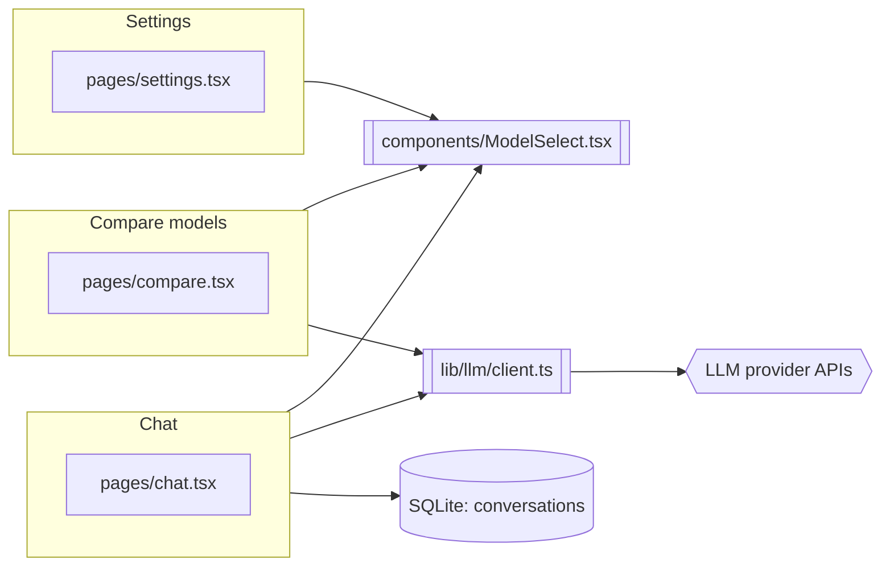

# Repo map & change cycle: setup brief

This brief sets up two things in a repository:

1. **A repo map**: what the app does, feature by feature, and which files, data and external services each feature uses.
2. **`change_cycle.md`**: a routine for testing a change, updating the map, opening a pull request and merging it, at one of three levels.

It works the same whether a developer or a coding agent does the setup.

## Deliverables

| File | Contents |
|---|---|
| `docs/repo-map.md` | Map board (diagram), feature entries, file → features index, sync line |
| `change_cycle.md` (repo root) | The routine, from the template in section 3, filled in for this repo |
| `docs/quality-exceptions.md` | Redundancies kept on purpose, each with a reason and a condition for fixing it |
| Tests | At least one automated test per feature |

If the repo has an agent instructions file (e.g. `AGENTS.md`, `CLAUDE.md`), add one line to it pointing to `docs/repo-map.md` and `change_cycle.md`.

The setup itself goes through a pull request. Merging it creates the first sync point (section 1d).

## 1. Repo map (`docs/repo-map.md`)

Map by **feature**, meaning something a user can do ("chat with a model", "sort models by provider"), not by every function in the code. Use the names people already use for these features.

### 1a. Map board

The file opens with a Mermaid diagram. GitHub and GitLab render it as a picture; in an editor you may need a Mermaid preview plugin.

- Each feature is a box containing its entry point(s).
- A file or component used by two or more features is its own node, linked to every feature that uses it.
- External services (LLM providers, APIs) and data stores (databases, files, local storage) are their own nodes.
- Past ~40 nodes, split into one diagram per area.



Duplication shows up on the board: four features with their own model dropdowns appear as four similar nodes instead of one shared node.

To rearrange the board by hand, paste the Mermaid code into a whiteboard tool that imports Mermaid (e.g. Excalidraw). The Mermaid code in the repo stays the source.

### 1b. Feature entries

```markdown
### Chat
What: send messages to an LLM and stream the replies.
Entry points: pages/chat.tsx, POST /api/chat
Files: pages/chat.tsx, components/ModelSelect.tsx, lib/llm/client.ts, api/chat.ts
Data: reads/writes the conversations table
External: LLM provider APIs (via lib/llm/client.ts)
Tests: tests/chat.spec.ts
```

### 1c. File → features index

Every file that runs or ships (code, config, styles, assets, migrations), with the features that use it. Docs, tests, and generated or vendored files are left out; tests are listed under their feature instead.

```markdown
| File | Features |
|---|---|
| components/ModelSelect.tsx | Chat, Compare models, Settings |
| export/** | Export |
| package-lock.json | ALL |
| scripts/seed.ts | none (dev tooling) |
```

- A folder pattern (`export/**`) can stand for all files under it when they serve the same features.
- `ALL` marks files every feature depends on: dependency manifests and lockfiles, build config, environment/config loading, database schema and migrations, the app shell, global styles, auth. A change to an `ALL` file makes Level 1 test every feature.
- `none` marks dev-only tooling.

### 1d. Sync line

Directly under the title:

```
Synced by change cycle: 2026-11-20, level 1, "add PDF export"
```

Every change cycle run rewrites this line, even when nothing else in the map changes. The last commit on the main branch that changed this line is the **sync point**: the map and tests are up to date as of that commit. Each run accounts for everything changed since then, including changes merged without a change cycle.

### Size

One file. Past ~500 lines, split into `docs/repo-map/` with an `index.md` (sync line, board, index table) and one file per area.

## 2. Tests

- Every feature needs at least one automated test of its main path. Where one is missing, write a smoke test. On repos with few tests, this is usually the largest part of the setup.
- Tests don't call paid or rate-limited services (LLMs, third-party APIs) by default; they use mocks or recorded responses. Live checks are opt-in (e.g. behind an environment variable) and listed in `change_cycle.md`.
- Tests run without secrets committed to the repo.

## 3. `change_cycle.md`

Copy this template to the repo root and replace every `<...>` with this repo's values. Commands must work when pasted as written.

````markdown
# Change cycle

Run with "run change_cycle.md level 1" (or 2, or 3). Each level includes everything in the levels before it.

| Level | Tests | Typical use |
|---|---|---|
| 1 | Features linked to the changed files | Everyday changes |
| 2 | The whole app | Before a release; after large or risky changes |
| 3 | The whole app + quality review | Periodic clean-up; after a large feature |

## Commands

- Base branch: `<main>`
- Install: `<command>`
- Test one feature: `<command>` (e.g. `npx vitest run tests/chat`)
- Full test suite: `<command>`
- Lint / type-check / build: `<commands, or "none">`
- Related tests (optional): `<command>` (e.g. `npx vitest related --run FILES`, `npx jest --findRelatedTests FILES`, `pytest --testmon`)
- Live checks (only when asked; they cost money): `<command, or "none">`
- Open a PR / merge it: `<commands>` (e.g. `gh pr create --title TITLE --body BODY`, `gh pr merge --squash --delete-branch`)

Files changed since the sync point (committed, uncommitted and new; bash):

```bash
git fetch origin
SYNC=$(git log -1 --format=%H -G'Synced by change cycle:' origin/<main> -- docs/repo-map.md docs/repo-map/index.md)
: "${SYNC:?no sync point found: check the whole map (level 2)}"
{ git diff --name-only --no-renames "$SYNC"; git ls-files --others --exclude-standard; } | sort -u
```

## Every level

1. Work on a branch updated from the latest `<main>`.
2. List the files changed since the sync point (command above). This covers this branch and anything merged since the last change cycle.
3. Update `docs/repo-map.md` for those files: add new features and files, remove deleted ones, fix renamed ones. Update the board if features, shared nodes, external services or data stores changed. Rewrite the sync line.
4. A new feature gets at least one test in the same change.
5. Run the level's checks. If one fails, fix it and rerun. Don't weaken or delete a test to make it pass unless the behavior change is intended and stated in the PR. If it can't be fixed within this change, stop without merging.
6. Open a PR with the summary below.
7. Merge once the level's checks pass. If `<main>` breaks after a merge, revert that PR first, then fix.

## Level 1: affected features

- Look up each changed file in the file → features index and run the tests of every feature listed (`ALL` means every feature).
- Run changed test files.
- Run lint / type-check if the repo has them.
- If the related-tests command is set, run it on the changed files. A test it finds that the map didn't point to means the map is wrong: fix the map and run that test too.

## Level 2: whole app

- Full test suite, lint, type-check and build.
- Check the map against the code: every file that runs or ships is in the index, every feature has a test, the board shows every feature.

## Level 3: quality review

Level 2, then review the whole repo, not only the changed files, for:

- **Duplicate implementations of the same thing.** Example: four separate model dropdowns where one shared component, with a simplified variant if needed, would do. Also duplicated API clients, model or provider lists, URLs, validation and formatting helpers. A shared component with variants is fine; copies are not.
- **Repeated remote calls.** LLM, API or database calls inside loops where one request carrying all items, the provider's batch API (for non-interactive jobs), bounded parallel requests or caching would do; the same data fetched by several components; polling where streaming, events or webhooks exist.
- **Other waste.** Dead code, unused dependencies, generic best-practice text copied into the repo (replace it with a link under References).
- **Also check:** secrets in code or committed config (move them to environment variables; the owner must rotate any secret that was ever committed), and errors that are caught and silently ignored.

Then:

1. Fix each finding unless it's too costly. Too costly (default; adjust per repo): the fix touches more than `<10>` files, or needs a change to a public API, database schema or stored data.
2. Fixes keep behavior the same. A fix that can't isn't made here; log it with "Why kept: needs owner decision".
3. Log every finding not fixed in `docs/quality-exceptions.md`.
4. Check every entry in `docs/quality-exceptions.md`. If its "Fix when" condition is met, fix it and delete the entry. Entries whose condition still holds are not reported again.
5. Rerun the Level 2 checks after the fixes.
6. Quality fixes go in their own PR, separate from feature changes, so either can be reverted alone.

## PR summary

```
Level: <1|2|3>
Changed since sync point: <files → features>
Checks run: <commands> — <pass/fail>
Map: <features/files added, removed, renamed; board updated: yes/no>
Quality fixes: <list, or "n/a">
Exceptions added/removed: <list, or "n/a">
```

## References

Generic guidance is linked here, never copied into the repo.

- <owner's guidelines, if any>
- <links picked from the setup brief's References section>
````

## 4. `docs/quality-exceptions.md`

Starts empty. One entry per redundancy kept on purpose:

```markdown
### Own model dropdown in the export dialog
Where: components/ModelSelect.tsx, export/ExportModelPicker.tsx
What: the export dialog has its own model dropdown instead of using ModelSelect.
Why kept: export reads models from the legacy /v1 API, which ModelSelect can't use.
Fix when: the /v1 API is removed.
Added: 2026-11-20, PR #57
```

"Why kept" names the specific blocker: a cost estimate, a technical constraint, an external dependency, or "needs owner decision". "Fix when" is a condition anyone can check. Level 3 checks it on every run; once it's met, the redundancy gets fixed and the entry deleted.

## 5. References: link, don't copy

Generic advice on building apps lives in maintained external sources. Copying it into the repo creates a second copy that goes stale. Pick the sources that fit the app and link them from `change_cycle.md`:

- Owner's own guidelines: `<link, or delete this line>`
- Any app: [Refactoring Guru: code smells](https://refactoring.guru/refactoring/smells), including duplicate and dead code
- Web apps: [web.dev Learn](https://web.dev/learn) (performance, accessibility); [The Twelve-Factor App](https://12factor.net) (config, backing services, deploys)
- Desktop apps: [Electron security checklist](https://electronjs.org/docs/latest/tutorial/security) or [Tauri security](https://v2.tauri.app/security/)
- Security, any app: [OWASP Cheat Sheet Series](https://cheatsheetseries.owasp.org)
- Apps that call LLMs: [OWASP Top 10 for LLM Applications](https://genai.owasp.org/llm-top-10/)

## Done when

- [ ] `docs/repo-map.md` has the board, an entry per feature, the index and the sync line.
- [ ] Five source files picked at random each appear in the index with the right features.
- [ ] Every feature lists at least one test, and the full suite passes.
- [ ] `change_cycle.md` is in the repo root with every `<...>` replaced and every command working.
- [ ] A trivial change (e.g. a comment) run through "run change_cycle.md level 1" ends in a merged PR with the summary filled in.
- [ ] `docs/quality-exceptions.md` exists (it may be empty).
